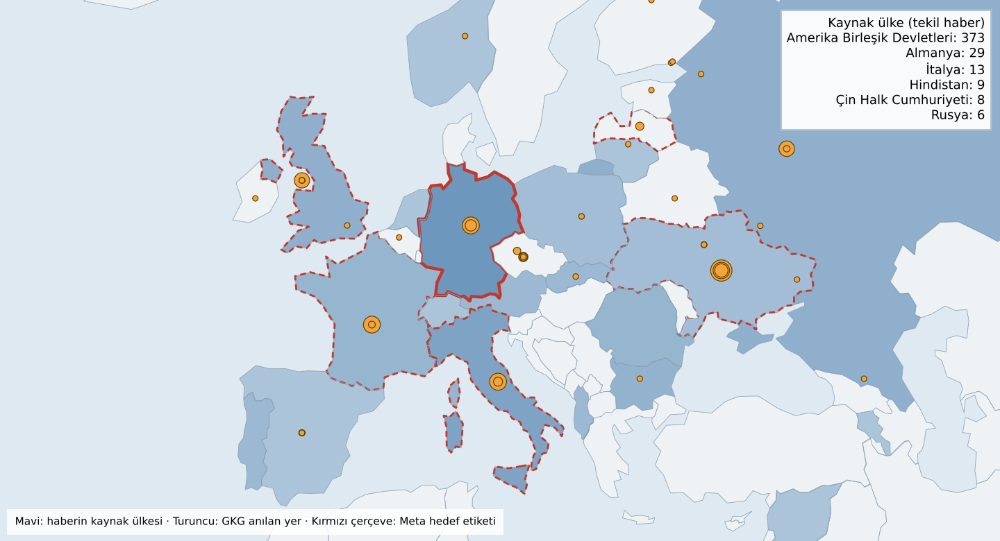

# Özet

Makale, Rusya kaynaklı Doppelgänger etki operasyonunun Eylül 2022’de ifşa edilen alan adı altyapısını ve bu ifşanın haber coğrafyasını, Meta’nın 311 benzersiz alan adı içeren gösterge listesi ile GDELT Küresel Bilgi Grafiği’nin MD5 doğrulamalı 4.209 ham dosyasındaki 5.944.850 haber kaydı üzerinden incelemektedir. Alan adlarının %95,8’i Almanya hedeflidir. Yeniden üretilebilir bir tipolojiye göre adların yalnızca %13,8’i gerçek bir haber markasını birebir taklit etmekte, %81,0’ı ise var olmayan “bağımsız yayın” adlarından oluşmaktadır; bu adların 174’ü Almanca ifadelerin harfleri karıştırılmış yazımlarından oluşan 19 aileye dağılmakta, %94,4’ü ise altı yeni genel uzantıda toplanmaktadır. Sabit kurallarla eşleşen 511 haberin %96,3’ü 27–28 Eylül’de yayımlanmıştır; 145 tekil başlığın tamamının kodlanmasıyla isabet %91,7 bulunmuştur. Haber düzeyinde ABD’deki yoğunluk Almanya’nınkinin 1,65 katıdır, ancak bu fark ajans haberlerinin yeniden yayımlanmasından kaynaklanmaktadır. Aktif yayın kuruluşlarına oranlandığında ifşayı haberleştiren kuruluş payı Almanya’da yaklaşık 2,5 kat yüksektir; Alman kuruluşlarının ortalamada daha büyük olması bu farkın bir kısmını açıklamaktadır. Bulgular, operasyon altyapısının büyük ölçüde uydurma bir yayıncılık kimliğine dayandığını, ifşanın hedef ülkenin medyasında sınırlı kalmadığını ve ülke karşılaştırmalarının sayım düzeyine duyarlı olduğunu göstermektedir.

**Anahtar kelimeler:** hibrit müdahale, dezenformasyon, Doppelgänger, alan adı taklidi, GDELT, haber coğrafyası

# Abstract

This article examines the domain infrastructure of the Russia-linked Doppelgänger influence operation disclosed in September 2022 and the news geography of that disclosure, using Meta’s indicator list (311 unique domains) and 5,944,850 records from 4,209 MD5-verified raw files of the GDELT Global Knowledge Graph. Meta labelled 95.8% of the domains as targeting Germany. A reproducible typology shows that only 13.8% exactly reproduce a real news brand, while 81.0% are invented “independent outlet” names; 174 of these fall into 19 families of letter-permuted German phrases, and 94.4% sit on six new generic extensions. Of 511 matched articles, 96.3% appeared on 27–28 September; coding all 145 distinct headlines yielded a precision of 91.7%. At the article level, US coverage intensity was 1.65 times that of Germany, a gap produced by wire-story syndication. Relative to active outlets, the share covering the disclosure was about 2.5 times higher in Germany, although German outlets were on average larger. The findings show that the infrastructure rested on an invented independent-media identity, that the disclosure was not marginal in the targeted country’s media, and that cross-country comparisons depend on the counting level.

**Keywords:** hybrid interference, disinformation, Doppelgänger, domain impersonation, GDELT, news geography

# 1. Giriş

EU DisinfoLab ile Qurium, 27 Eylül 2022’de Bild, Der Spiegel, The Guardian ve ANSA dahil en az 17 medya markasını taklit eden ve en geç Mayıs 2022’den beri süren bir kampanyayı raporlamıştır (Alaphilippe vd., 2022). Meta da aynı gün Rusya kaynaklı bir ağı platformlarından kaldırdığını, ağın öncelikle Almanya’yı, ayrıca Fransa, İtalya, Ukrayna ve Birleşik Krallık’ı hedeflediğini ve 60’tan fazla taklit haber sitesi çevresinde kurulduğunu açıklamıştır (Nimmo ve Agranovich, 2022). Kampanya, sonraki aylarda “Doppelgänger” adıyla anılmaya başlanmıştır. Fransa’nın dijital müdahalelerle mücadele birimi VIGINUM, Haziran 2023’te kampanyanın Rus aktörlerce yürütüldüğünü tespit etmiştir (Ministère de l’Europe et des Affaires étrangères, 2023). Avrupa Birliği Konseyi 28 Temmuz 2023’te kampanyayla ilişkili kişi ve kuruluşları yaptırım listesine almış (Council of the European Union, 2023), ABD Hazinesi 20 Mart 2024’te Sosyal Tasarım Ajansı (SDA) ve Structura şirketleri ile yöneticilerine yaptırım uygulamış (U.S. Department of the Treasury, 2024), ABD Adalet Bakanlığı ise 4 Eylül 2024’te kampanyaya ait 32 alan adına el koymuştur (U.S. Department of Justice, 2024). Alman Dışişleri Bakanlığı da kampanyanın 2024’te Almanya’yı hedeflemeyi sürdürdüğünü raporlamıştır (Auswärtiges Amt, 2024a, 2024b).

Doppelgänger hakkındaki bilginin büyük kısmı platform açıklamalarına, hükümet belgelerine ve araştırma kuruluşlarının raporlarına dayanmaktadır. Sızdırılmış SDA belgelerini inceleyen en kapsamlı değerlendirme de bir araştırma enstitüsü raporu olarak yayımlanmıştır (Pamment ve Tsurtsumia, 2025). Rusya’nın Avrupa’daki etki faaliyetlerini ele alan hakemli çalışmalar ise istihbarat raporlarının sentezine (Karlsen, 2019), sosyal medya içeriğine (Golovchenko, 2020) ya da devlet haber ajanslarının çerçevelerine (Watanabe, 2017) odaklanmaktadır. Platformların yayımladığı gösterge listelerini kayıt düzeyinde inceleyen ve bunları bir ifşanın haber coğrafyasıyla birlikte değerlendiren çalışmalar sınırlı sayıdadır.

Makale, operasyonun bıraktığı iki iz üzerinden ilerlemektedir: Meta’nın yayımladığı ve operasyonun adres altyapısını gösteren alan adı göstergeleri ile kamuoyunun operasyon hakkında neyi, nerede ve ne kadar süre gördüğünü gösteren ifşa haberleri. Bu çerçevede üç araştırma sorusu yanıtlanmaktadır:

- **AS1.** Yayımlanan göstergeler hangi ülkeleri hedef olarak etiketlemektedir?
- **AS2.** Alan adları hangi taklit örüntülerini izlemektedir?
- **AS3.** İfşa ne zaman ve hangi ülkelerin haber kaynaklarında, hangi yoğunlukta yer almıştır?

Çalışmanın katkısı, kayıt düzeyinde yeniden üretilebilir bir alan adı tipolojisini MD5 doğrulamalı bir haber arşivi taramasıyla aynı vakada birleştirmesi ve ifşanın coğrafyasını haber, yayın kuruluşu ve tekil başlık düzeylerinde ayrı ayrı ölçmesidir. Çalışma erişim, maruziyet ya da etki ölçmemektedir; bulguların yorumu bu sınıra bağlıdır (bkz. Bölüm 7).

# 2. Kuramsal Çerçeve

## 2.1. Hibrit savaştan hibrit müdahaleye

“Hibrit savaş” terimi Rusya’ya özgü bir kavram olarak doğmamıştır. Terimin erken kullanımlarından biri, Çeçen ayrılıkçı hareketi örneğinde modern ve devlet öncesi toplumsal biçimlerin birleştiği bir savaş tipini inceleyen Nemeth’in (2002) yüksek lisans tezidir. Kavramı stratejik literatürde yaygınlaştıran Hoffman (2007), konvansiyonel kabiliyetlerin, düzensiz taktiklerin, terörizmin ve suçun aynı muharebe alanında eşzamanlı olarak kaynaştığı savaşları tanımlamıştır ve dezenformasyon bu tanımın çekirdeğinde yer almamaktadır. Kırım’ın 2014’te ilhakından sonra kavram, askerî olmayan araçları da kapsayan “hibrit tehditler” çerçevesine doğru genişlemiştir. Avrupa Hibrit Tehditlerle Mücadele Mükemmeliyet Merkezi bu tehditleri, demokratik devletlerin sistemik kırılganlıklarını hedefleyen ve tespit ile atıf eşiklerini istismar eden koordineli eylemler olarak tanımlamaktadır (Hybrid CoE, t.y.).

Kavramın genişlemesi ciddi eleştirilere yol açmıştır. Renz (2016), Kırım sonrasında “hibrit savaş”ın Rus askerî gücünü anlatan baskın bir etikete dönüştüğünü ve askerî olmayan araçların yeniliğinin abartıldığını savunmaktadır. Fridman (2018), terimin hem Batı’da hem de Rus *gibridnaya voyna* söyleminde siyasallaştığını ve Rus metinlerinde hibrit savaşı yürüten tarafın çoğu kez Batı olarak kurgulandığını göstermektedir. “Gerasimov doktrini” ifadesini ilk kullanan Galeotti (2018) da Gerasimov’un 2013 tarihli makalesinin bir Rus doktrinini değil, Rus Genelkurmayı’nın Batı’ya atfettiği yöntemleri anlattığını belirterek etiketi geri çekmiştir. Caliskan (2019) ise strateji kuramı açısından hibrit savaşın yeni bir savaş biçimi olmadığını, savaşın değişen karakterine ilişkin bir betimleme olduğunu ileri sürmektedir. Türkçe literatürde kavram çoğunlukla Rusya’nın Ukrayna müdahaleleri üzerinden ve askerî boyutuyla tartışılmıştır (Aras ve Yıldırım, 2022; Özdemir ve Eminoğlu, 2022).

Söz konusu eleştiriler, kavramın terk edilmesinden çok daraltılmasını gerekli kılmaktadır. Wigell (2019), dış aktörlerin dezenformasyon, örtülü diplomasi ve jeoekonomik araçlarla hedef toplumlarda kamalar açtığı ve liberal demokrasinin açıklığından yararlandığı durumları “hibrit müdahale” kavramıyla açıklamaktadır. Mumford ve Carlucci (2023) ise hibrit savaşın analitik çekirdeğini stratejik belirsizlik olarak tanımlamaktadır. Makalede **hibrit müdahale**, devlet ya da devlet bağlantılı aktörlerin savaş eşiğinin altında kalarak, tespit ve atıf eşiklerini istismar eden, açık toplumların bilgi altyapısındaki güven ilişkilerini hedef alan koordineli ve inkâr edilebilir askerî olmayan faaliyetleri olarak tanımlanmaktadır. Başlıktaki “görünmez cephe” ifadesi de bu tanımdan türemektedir: operasyon bilinçli olarak tespit eşiğinin altında tutulmakta, operasyona dair kamusal bilgi ise büyük ölçüde ifşa anında ortaya çıkmaktadır.

Lanoszka (2016), hibrit araçların özellikle Rusça konuşan azınlıkları bulunan ve askerî açıdan kırılgan Doğu Avrupa ülkelerinde etkili olacağını savunmaktadır. Makalede bu argüman bir kapsam koşulu olarak kullanılmaktadır. Almanya’da Rusya’nın kullanabileceği askerî bir kaldıraç bulunmamakla birlikte etnik kaldıraç tümüyle yok değildir; Almanya, Avrupa Birliği’ndeki en büyük Rusça konuşan topluluklardan birine ev sahipliği yapmaktadır (Meister, 2016). Ocak 2016’daki “Lisa vakası”nda, Rus devlet televizyonunun Rus-Alman bir kız çocuğuna göçmenlerin saldırdığı yönündeki asılsız haberi bu kaldıracın kullanılmasının bilinen bir örneği olmuştur (Meister, 2016). Dolayısıyla Almanya’da etnik kaldıraç sınırlı ve dolaylı, askerî kaldıraç ise yoktur; bilgi alanındaki inkâr edilebilir faaliyetler müdahalenin başlıca kanalı olarak öne çıkmaktadır. Karlsen’in (2019) Batı’daki 15 istihbarat ve güvenlik servisinin yaklaşık 40 adet yıllık raporuna dayanan analizi de Rus etki faaliyetlerinin Avrupa’da asıl olarak toplumları bölmeye ve AB ile NATO’yu zayıflatmaya yöneldiğini göstermektedir.

## 2.2. Ödünç alınmış güvenilirlik ve alan adı taklidi

Operasyonun amacını stratejik anlatı kavramı açıklamaktadır: devletler, uluslararası düzenin geçmişine ve geleceğine ilişkin ortak bir anlam inşa etmek için anlatılar kurmaktadır (Miskimmon vd., 2013). Paul ve Matthews (2016) ise Rus propagandasını yüksek hacimli, çok kanallı, hızlı ve tutarlılığa aldırmayan bir “yalan hortumu” olarak modellemektedir. Kanıtlanmış bir doktrin olmamakla birlikte bu model, çok sayıda kısa ömürlü adresin neden işe koşulduğunu anlamaya yardımcı olmaktadır.

Bennett ve Livingston (2018), dezenformasyonu siyasal amaçlarla haber öyküsü ya da belgesel biçimlerini taklit eden kasıtlı yanlışlar olarak tanımlamaktadır. Wardle ve Derakhshan’ın (2017) oluşturma, üretim ve dağıtım evrelerinden oluşan bilgi düzensizliği çerçevesinde taklit haber siteleri hem üretim hem de dağıtım altyapısıdır. Lazer vd. (2018) de yalan haberi, haber medyasının biçimini taklit eden ancak onun örgütsel süreçlerinden yoksun içerik olarak tanımlamaktadır. Okurların kaynağın güvenilirliğini çoğu zaman tanıdık bir marka ve görünüm gibi kısa yollarla değerlendirmesi, taklit adreslerin işlevini açıklamaktadır.

Bilgisayar güvenliği literatürü benzer alan adlarını sistematik biçimde sınıflandırmaktadır. Tian vd. (2018), yazım hatası (*typosquatting*), birleştirme (*combosquatting*), homograf, bit değişimi ve yanlış uzantı (*wrongTLD*) türlerini ayırmaktadır; marka adının aynen korunup yalnızca uzantının değiştiği tür wrongTLD’dir. Korczyński vd. (2018) ise alan adı kötüye kullanımının yeni genel uzantılarda yoğunlaştığını ve kayıt kurallarının sıkı olduğu uzantılarda azaldığını göstermektedir. Bu iki çalışmadan AS2 için iki beklenti türetilmiştir: taklitlerin önemli bir kısmının marka adını koruyup uzantıyı değiştirmesi ve yeni genel uzantıların tercih edilmesi.

## 2.3. İfşa, görünürlük ve algı korsanlığı

Bir operasyonun ifşası kendi başına bir iletişim olayıdır. Haber akışı literatürü, uluslararası haberin seçkin ülkeler ve büyük ajanslar etrafında yoğunlaştığını uzun süredir göstermektedir (Galtung ve Ruge, 1965). Kwak ve An (2014) de GDELT verisiyle afet haberlerinde güçlü bir bölgeselcilik bulmuştur. Bu bulgulardan AS3 için ifşanın kısa ömürlü, tetikleyici olaya bağlı ve büyük ajans ağları üzerinden dolaşan bir görünürlük kazanacağı beklentisi türetilmiştir.

İfşanın görünürlüğü operasyonun başarısı anlamına gelmemektedir. Eady vd. (2023), 2016 ABD seçiminde Rus İnternet Araştırma Ajansı içeriğine maruziyetin kullanıcıların %1’inde yoğunlaştığını ve tutum ya da oy davranışıyla ilişkisinin saptanmadığını bulmuştur. Sızdırılmış SDA belgeleri ise operatörlerin Batı medyasındaki haberleri müşterilerine başarı kanıtı olarak sunduğunu göstermektedir (Pamment ve Tsurtsumia, 2025). Platform araştırmacılarının “algı korsanlığı” olarak adlandırdığı bu olguda operatör, olduğundan daha etkili görünmeye çalışmaktadır. Jungherr ve Rauchfleisch (2024) ise alarmist dezenformasyon söyleminin demokrasiden memnuniyeti düşürebildiğini deneysel olarak göstermiştir. İfşanın nerede ve ne yoğunlukta haberleştirildiği, bu nedenle hibrit müdahalenin bilgi boyutunda ayrı bir ölçüm konusu oluşturmaktadır.

# 3. Vaka: Doppelgänger, 2022–2025

Kampanya, 27 Eylül 2022’de aynı gün yapılan iki ifşayla görünür olmuştur (Alaphilippe vd., 2022; Nimmo ve Agranovich, 2022). Meta, açıklamasında soruşturmanın Almanya’daki araştırmacı gazetecilerin kampanyanın bir bölümüne ilişkin haberlerinin ardından başladığını belirtmiş, ancak ağı belirli bir kuruluşa atfetmemiştir. Atıf sonraki aylarda netleşmiştir. VIGINUM’un Haziran 2023 tarihli tespiti, Avrupa Birliği’nin Temmuz 2023 yaptırımları, ABD Hazinesi’nin Mart 2024 yaptırımları ve ABD Adalet Bakanlığı’nın Eylül 2024 tarihli el koyma kararı, kampanyayı SDA ve Structura şirketleriyle ilişkilendirmiştir (Council of the European Union, 2023; Ministère de l’Europe et des Affaires étrangères, 2023; U.S. Department of Justice, 2024; U.S. Department of the Treasury, 2024). Alman Dışişleri Bakanlığı, 20 Aralık 2023 – 20 Ocak 2024 döneminde 50.000’den fazla sahte X hesabının 1,8 milyondan fazla Almanca gönderi yayımladığını raporlamış (Auswärtiges Amt, 2024a), Haziran 2024 raporunda da kampanyanın sürdüğünü bildirmiştir (Auswärtiges Amt, 2024b). Pamment ve Tsurtsumia (2025), 3.000’den fazla sızdırılmış SDA belgesine dayanarak kampanyanın etkisinin abartıldığı sonucuna varmıştır.

Kronoloji, incelenen verinin niteliğini belirlemektedir. 2022 gösterge listesi, operasyonun ilk evresine ait ve platform tarafından seçilerek yayımlanmış bir anlık görüntüdür. Rogers ve Righetti (2025), Meta’nın koordineli sahte davranış tanımının zaman içinde daraldığını göstermiştir. Liste bu nedenle platformun 2022’deki uygulama kararlarının bir kaydı olarak ele alınmış ve operasyonun alt sınırını gösterdiği kabul edilmiştir.

# 4. Veri ve Yöntem

## 4.1. Meta gösterge verisi

Meta’nın tehdit araştırması deposunda yer alan 27 Eylül 2022 tarihli gösterge dosyası sabit bir commit bağlantısından indirilmiş ve SHA-256 özeti kaydedilmiştir (Meta, 2022). Dosyadaki 350 kaydın 313’ü alan adı türündedir; küçük harfe dönüştürülmüş tam alan adı üzerinde yapılan tekilleştirmeyle iki yinelenen kayıt çıkarılmış ve 311 benzersiz alan adı elde edilmiştir. Dosyadaki 22 Facebook ve 15 Telegram bağlantısı farklı analiz birimleri olduğu için paydaya katılmamıştır. Hedef ülke, kaynağın yorum alanındaki etiketten alınmış; uzantıdan, IP adresinden ya da barındırma bilgisinden ülke çıkarımı yapılmamıştır. Kayıtların tamamında tarih alanı 27 Eylül 2022 olduğundan faaliyetin zaman içindeki seyrine ilişkin çıkarım yapılmamıştır.

## 4.2. Alan adı tipolojisinin operasyonelleştirilmesi

Her alan adının ilk DNS etiketi (ilk noktadan önceki dize) ve son DNS etiketi (son noktadan sonraki dize) ayrıştırılmıştır. İlk etiketler, 15 yayın kuruluşunun alan adı etiketlerinden oluşan sabit bir listeyle karşılaştırılarak üç sınıfa ayrılmıştır. Liste, vaka raporlarında taklit edildiği belirtilen markalardan (Alaphilippe vd., 2022; Nimmo ve Agranovich, 2022) ve gösterge listesinde tanınabilir bir haber markası adı taşıyan etiketlerden derlenmiştir:

- **Marka birebir:** İlk etiket, gerçek bir yayın kuruluşunun etiketiyle aynıdır (örneğin *spiegel*). Uzantı farklı olduğunda bu sınıf, Tian vd.’nin (2018) wrongTLD türüne karşılık gelmektedir.
- **Marka varyantı:** İlk etiket bir yayın kuruluşu etiketine Damerau–Levenshtein uzaklığıyla yakındır (örneğin *spiegeli*, *t-onlinr*). Eşik, en fazla iki düzenleme olacak ve marka etiketi uzunluğunun yarısını aşmayacak biçimde belirlenmiştir.
- **Uydurma yayın adı:** Diğer etiketlerdir ve var olan bir haber markasına ait değildir.

Uydurma yayın adları içinde harf çoklu kümesi (sıralanmış harfleri) aynı olan farklı yazımlar “harf karışımı ailesi” olarak gruplandırılmıştır; örneğin *dassprachrohr*, *dassprahcrohr* ve *dassrpahcorhr* aynı ailededir. Kural yalnızca birebir harf eşitliğine dayandığından, sesli harfi düşürülmüş yazımlar (örneğin *dknuzsrntch*) ayrı tutulmakta ve aile sayısı muhafazakâr bir alt sınır vermektedir. Eşiğin bir düzenlemeye indirildiği duyarlılık analizinde sınıf sayıları değişmemiştir. Kısa etiketlerden *rbk*, RBC Ukraine markasının Rusça adının (РБК) Latin harfli yazımı olarak değerlendirilebileceğinden “marka varyantı” sınıfında tutulmuştur; birebir marka sayılması durumunda birebir taklit sayısı 44’e yükselmektedir.

## 4.3. GDELT GKG ham arşivi

Haber verisi için GDELT’in canlı arama arayüzü yerine, GDELT literatüründe kullanılan Küresel Bilgi Grafiği 2.0 ham arşivi kullanılmıştır (Leetaru ve Schrodt, 2013; The GDELT Project, 2015). Arama arayüzü resmî olarak yalnızca son üç ayı kapsamakta, ham arşiv ise sabit dosyalardan oluştuğu için başka araştırmacılarca birebir yeniden taranabilmektedir. 20 Eylül – 11 Ekim 2022 dönemine ait 15 dakikalık İngilizce ve çeviri (translingual) dosyaları GDELT’in yayımladığı dosya listelerinden belirlenmiştir. Listelerde bu dönem için 4.209 dosya yer almaktadır (İngilizce akış 2.112, çeviri akışı 2.097); kesintisiz bir yayında beklenen sayı 4.224’tür ve aradaki 15 dosya GDELT’in listesinde bulunmamaktadır. İndirilen her dosyanın boyutu ve MD5 özeti GDELT’in listede verdiği değerlerle karşılaştırılmış, 4.209 dosyanın tamamının eşleştiği görülmüş ve toplam 5.944.850 haber kaydı taranmıştır.

Haberin yayımlandığı ülke, GDELT’in alan adı–ülke eşleştirme dosyasından alınmıştır (The GDELT Project, 2018). GDELT bu eşleştirmede bir yayın kuruluşunu haberlerinde en sık andığı ülkeye atamaktadır; değişken bu nedenle “GDELT’in çıkarımına göre yayın ülkesi” olarak okunmalıdır ve okurun bulunduğu ülkeyi göstermemektedir. Haberde anılan yerler aynı kayıtların V2Locations alanından alınmıştır. Her gün ve her yayın ülkesi için taranan bütün kayıtlar ile dönem içinde en az bir kayıt üreten farklı alan adları (aktif yayın kuruluşları) payda olarak saklanmıştır.

## 4.4. Eşleşme kuralları, isabet ve duyarlılık

Haberler, sayfa başlığı ve URL üzerinde çalışan sabit kurallarla seçilmiştir. R1 kuralı “doppelgänger” yazımlarından birinin bir Rusya bağlamıyla birlikte geçmesini, R2 kuralı Meta, Facebook ya da Instagram adının bir Rusya terimiyle ve ağ, sahte, propaganda, dezenformasyon ya da kaldırma anlamına gelen çok dilli bir terimle birlikte geçmesini, Almanca ifşa haberlerini yakalamak için eklenen R3 kuralı ise sahtecilik ya da klonlama anlamına gelen Almanca bir terimin bir yayın ya da medya terimi ve bir Rusya terimiyle birlikte geçmesini aramaktadır. Eşleşmeler URL düzeyinde tekilleştirilmiştir.

İsabet iki yolla ölçülmüştür. Birincisinde sabit tohumla (2022) çekilen rastgele bir örneklem kodlanmıştır; R2 için 30 başlık, R1 yalnızca iki eşleşme ürettiği için bu iki başlık örnekleme alınmıştır. İkincisinde eşleşen haberlerin taşıdığı 145 tekil başlığın tamamı kodlanmıştır. Kodlama kuralı sayımdan önce sabitlenmiştir: bir başlık, Meta’nın 27 Eylül 2022 tarihli kaldırma duyurusunu (aynı duyuruda yer alan Rus ve Çin ağları dahil) ya da Doppelgänger kampanyasını konu alıyorsa ilgili sayılmıştır. Wang vd. (2016), GDELT olay verisinin isabetinin denetlenmesi gerektiğini göstermiştir.

Duyarlılık, yani kuralların kaçırdığı ilgili haberlerin oranı, iki bağımsız havuzla sınanmıştır. Birinci havuz, kuralların hiçbirini karşılamayan, ancak Almanca yazılmış ya da Almanya kaynaklı olup başlığında bir Rusya terimiyle geniş bir dezenformasyon ya da platform terimini birlikte taşıyan bütün kayıtlardan oluşmaktadır. İkinci havuz, 26–30 Eylül 2022 arasındaki Almanca ve Almanya kaynaklı kayıtların Rusya şartı aranmaksızın gevşek bir sahtecilik ve medya terimi kuralıyla yeniden taranmasıyla oluşturulmuştur. Her iki havuzdaki kayıtların tamamı aynı kodlama kuralıyla kodlanmıştır.

## 4.5. İstatistiksel yöntem

Oranlar için Wilson %95 güven aralıkları hesaplanmıştır. İfşanın coğrafyası üç düzeyde ölçülmüştür. Haber düzeyinde, eşleşen haber sayısı o ülkeden taranan kayıt sayısına oranlanmış ve 100.000 kayıt başına raporlanmıştır; bu oranlar için kesin Poisson güven aralıkları kullanılmıştır. Yayın kuruluşu düzeyinde, ifşayı en az bir kez haberleştiren kuruluş sayısı o ülkede dönem içinde aktif olan kuruluş sayısına oranlanmış ve 1.000 aktif kuruluş başına raporlanmıştır. Tekil başlık düzeyinde ise ülke başına farklı başlık sayısı verilmiştir. ABD ile Almanya arasındaki oranlar logaritmik ölçekte normal yaklaşımla hesaplanmıştır. Ajans haberlerinin yeniden yayımlanmasından en az etkilenen düzey yayın kuruluşu düzeyi olduğundan, ülke karşılaştırmasında asıl ölçüt olarak bu düzey kullanılmıştır.

# 5. Bulgular

## 5.1. Hedefleme (AS1)

311 alan adının 298’i (%95,8) Meta tarafından Almanya hedefli olarak etiketlenmiştir; diğer etiketler Birleşik Krallık (4), Letonya (3), Fransa (2), İtalya (2), Ukrayna (1) ve birden fazla ülke (1) biçiminde dağılmaktadır. Yoğunlaşma, Meta’nın ve EU DisinfoLab’in Almanya’yı öncelikli hedef olarak tanımlamasıyla uyumludur. Ne var ki Meta’nın açıklaması Fransa, İtalya, Ukrayna ve Birleşik Krallık’ı da saymaktadır ve göstergelerdeki dağılım platformun yayımladığı alan adı altyapısıyla sınırlıdır.

## 5.2. Alan adı altyapısı (AS2)

Tipolojinin sonuçları Tablo 1’de verilmiştir.

**Tablo 1.** Meta gösterge listesindeki alan adlarının tipolojisi (N = 311)

| Sınıf | Alan adı | Pay | Almanya etiketli | En sık altı uzantıda |
|---|---:|---:|---:|---:|
| Marka birebir | 43 | %13,8 | 34 | 2 |
| Marka varyantı | 16 | %5,1 | 14 | 0 |
| Uydurma yayın adı | 252 | %81,0 | 250 | 238 |
| Toplam | 311 | %100,0 | 298 | 240 |

*Not.* En sık altı son DNS etiketi: *online* (53), *website* (50), *site* (46), *space* (42), *pw* (28), *fun* (21).

Birebir marka taklitleri 13 yayın kuruluşuna dağılmaktadır: Der Spiegel (9), Bild (8), Süddeutsche Zeitung (4), Die Welt (4), Daily Mail (3), Delfi (3), FAZ (3), nd (3), Tagesspiegel (2), ANSA (1), La Repubblica (1), t-online (1) ve The Guardian (1). Söz konusu 43 alan adı 27 farklı uzantıya yayılmıştır ve hiçbir uzantıda beşten fazla birebir taklit bulunmamaktadır (örneğin *bild.asia*, *bild.expert*, *ansa.ltd*). Marka varyantları ise adın bir harfinin değiştirilmesi ya da eklenmesiyle oluşturulmuştur (*spiegeli*, *spiegelr*, *t-onlinl*, *t-onlinr*, *tonline*, *20minuts*, *rbk*).

Altyapının büyük bölümünü var olmayan yayınların adları oluşturmaktadır. 252 uydurma yayın adı 73 farklı ilk etiket taşımaktadır ve bu etiketlerin çoğu “denk zuerst nach” (önce düşün), “Wahrheit” (hakikat), “offene Meinung” (açık fikir), “lerne zu denken” (düşünmeyi öğren), “Offenbarung” (ifşa) ya da “das Sprachrohr” (sözcü) gibi Almanca ifadelerin harfleri karıştırılmış yazımlarıdır. Birebir harf eşitliği kuralına göre 45 etiket 19 harf karışımı ailesi oluşturmakta ve bu ailelerde toplam 174 alan adı bulunmaktadır. Uydurma yayın adlarının 238’i (%94,4) en sık altı uzantıda toplanmıştır; bu uzantılardaki 240 alan adından yalnızca ikisi bir markayı birebir taklit etmektedir.

AS2’nin ilk beklentisi büyük ölçüde karşılanmamıştır: marka adını koruyup uzantıyı değiştiren wrongTLD türü altyapının yalnızca küçük bir kesimini oluşturmaktadır. Altyapının asıl stratejisi, sahte bir “bağımsız Alman yayını” kimliği üretmek ve bu kimliği harf karışımı yazımlarla çok sayıda adrese çoğaltmaktır. İkinci beklenti ise doğrulanmıştır: çoğaltılan adresler, Korczyński vd.’nin (2018) kötüye kullanımın yoğunlaştığını gösterdiği yeni genel uzantılarda (ve genel amaçlı pazarlanan *.pw* uzantısında) toplanmaktadır. Uzantıların kayıt maliyetleri incelenmemiştir.

## 5.3. Eşleşmelerin isabeti ve duyarlılığı

Kurallar 511 tekil haberle eşleşmiştir; bunların 509’u R2’den, 2’si R1’den gelmektedir ve R3 hiçbir haberle eşleşmemiştir. Rastgele örneklemde R2 için 30 başlığın 28’i (%93,3), R1 için iki başlığın biri ilgili bulunmuştur. Kural büyüklüklerine göre ağırlıklandırılmış isabet %93,2’dir. 145 tekil başlığın tamamının kodlanmasında 133 başlık ilgili bulunmuş, başlık düzeyinde isabet %91,7 (Wilson %95 GA 86,1–95,2) ve haber düzeyinde isabet %96,9 olarak hesaplanmıştır. İlgisiz başlıklar Apple’ın VK uygulamasını mağazasından kaldırmasına, Rusya’nın Ekim 2022’de Meta’ya yönelik kararlarına, Putin’in “dublörleri” üzerine bir habere ve Finlandiya sınırına ilişkindir. R1’in iki eşleşmesinden biri ilgisizdir; kampanya adı 2022 haberlerinde neredeyse hiç kullanılmamıştır.

Birinci duyarlılık havuzundaki 270 kaydın yalnızca biri ilgilidir: İsviçre kaynaklı watson.ch’nin 27 Eylül tarihli “Facebook bestätigt: So hat Putins Troll-Armee Westeuropa attackiert” başlıklı haberi. İkinci havuzda 77 kayıt bulunmuş, bunların sekizi ifşa haberi olarak kodlanmıştır. Sekiz haberin yedisi (%87,5; Wilson %95 GA 52,9–97,8) kurallarca zaten yakalanmıştır; kaçan tek haber yine watson.ch haberidir. Bu havuzdaki Almanya kaynaklı üç ifşa haberinin (ZDF, Der Spiegel, Bürstädter Zeitung) üçü de yakalanmıştır. Kuralların Almanca ifşa haberlerini sistematik olarak kaçırdığına ilişkin bir bulguya rastlanmamıştır.

## 5.4. İfşanın zamanı (AS3)

Eşleşmelerin günlere göre dağılımı Şekil 1’de gösterilmektedir. 27 Eylül’de 392, 28 Eylül’de 100 haber yayımlanmıştır ve bu iki gün eşleşmelerin %96,3’ünü oluşturmaktadır. Taranan bütün kayıtlara oranlanmış seri aynı biçimi izlemektedir; zirve, o günlerdeki genel haber hacmine bağlı değildir. 28 Eylül’den sonraki 13 günde toplam 18 haber bulunmaktadır. 27 Eylül’den önceki tek eşleşme, 21 Eylül tarihli “Russische Kriegspropaganda im Netz: Facebook reagiert verzögert” başlıklı FAZ haberidir. Meta’nın soruşturmanın Alman gazetecilerin haberlerinin ardından başladığı yönündeki açıklamasıyla birlikte değerlendirildiğinde, bu haber ifşa öncesine ait bir öncül olarak kabul edilmiştir.

511 haber yalnızca 145 farklı başlık taşımakta ve 352 farklı yayın kuruluşundan gelmektedir. En sık tekrarlanan başlıklar büyük ajans haberleridir; örneğin “Meta disables Russian propaganda network targeting Europe” başlığı çok sayıda yerel sitede aynen yayımlanmıştır. Haberlerin %81,4’ü İngilizcedir, Almanca haber sayısı ise 35’tir.

## 5.5. İfşanın coğrafyası (AS3)

Tablo 2, eşleşen haberlerin en fazla olduğu üç yayın ülkesini üç sayım düzeyinde karşılaştırmaktadır. Beş ve daha fazla haberi bulunan bütün ülkeler 100.000 kayıt başına orana göre ABD, Almanya, Bulgaristan, Kanada, İtalya, Hindistan, Çin, Rusya ve Birleşik Krallık biçiminde sıralanmaktadır. Saptanan 36 yayın ülkesinin tamamı Ek A’da verilmiştir; 8 haberin alan adı GDELT eşleştirme dosyasında bulunmamaktadır.

**Tablo 2.** Üç sayım düzeyinde ifşanın yayın ülkesine göre dağılımı

| Yayın ülkesi | Haber | 100.000 kayıt başına (%95 GA) | Yayın kuruluşu / aktif kuruluş | 1.000 aktif kuruluş başına (%95 GA) | Tekil başlık |
|-------------|--------:|----------------------|---------------:|-------------------------|--------:|
| ABD | 373 | 25,39 (22,88–28,10) | 230 / 6.786 | 33,89 (29,84–38,47) | 63 |
| Almanya | 29 | 15,38 (10,30–22,09) | 29 / 347 | 83,57 (58,82–117,45) | 13 |
| İtalya | 13 | 5,41 (2,88–9,25) | 9 / 488 | 18,44 (9,73–34,68) | 11 |

Haber düzeyinde ABD öndedir: haberlerin %73,0’ı ABD’de, %5,7’si Almanya’da yayımlanmıştır ve ABD’deki yoğunluk Almanya’dakinin 1,65 katıdır (%95 GA 1,13–2,41). Fark ise büyük ölçüde ajans haberlerinin yeniden yayımlanmasından kaynaklanmaktadır; 373 ABD haberi 230 kuruluştan gelmekle birlikte yalnızca 63 farklı başlık taşımaktadır. Almanya’daki 29 haber ise 29 ayrı kuruluş tarafından ve 13 farklı başlıkla yayımlanmıştır. Yayın kuruluşu düzeyinde tablo tersine dönmektedir: dönem içinde aktif olan Alman kuruluşlarının binde 83,57’si ifşayı haberleştirmişken bu oran ABD’de binde 33,89’dur. ABD’nin Almanya’ya oranı 0,41’dir (%95 GA 0,28–0,59); başka bir ifadeyle Alman yayın kuruluşlarının ifşayı haberleştirme olasılığı 2,47 kat daha yüksektir (%95 GA 1,70–3,57). Ne var ki iki ülkedeki kuruluşların ortalama büyüklüğü de farklıdır: dönem içinde ABD’deki bir kuruluş ortalama 217, Almanya’daki bir kuruluş ise ortalama 543 kayıt üretmiştir (oran 2,51). Daha fazla haber üreten bir kuruluşun ifşayı haberleştirme olasılığı da kendiliğinden daha yüksek olacağından, kuruluş düzeyindeki farkın önemli bir kısmı bu büyüklük farkıyla açıklanabilir.

Haberlerde anılan yerler incelendiğinde haberlerin %63,6’sının Almanya’yı, %57,1’inin Fransa’yı ve İtalya’yı, %46,2’sinin Birleşik Krallık’ı andığı görülmektedir (Şekil 2). Ne var ki Fransa’yı anan 292 haberin 288’i (%98,6) İtalya’yı da anmaktadır; bu örüntü, anmaların büyük ölçüde ajans haberinde yer alan hedef ülke listesinden kaynaklandığını düşündürmektedir. Anılan yer verisi bu nedenle ajans metninin bir yansıması olarak yorumlanmıştır.

# 6. Tartışma

Hedefleme bulgusu, Almanya’ya ayrılan altyapı payının Doppelgänger raporlarındaki nitel vurguyla uyumlu olduğunu göstermektedir. Lanoszka’nın (2016) kapsam koşulu açısından bakıldığında, askerî kaldıracın bulunmadığı ve etnik kaldıracın sınırlı ve dolaylı olduğu büyük bir Batı Avrupa toplumunda müdahalenin bilgi altyapısındaki güven ilişkilerine yöneldiği görülmektedir. Alan adı sayısı ise bir yatırım ve öncelik göstergesidir ve Alman okurların bu adreslerle ne ölçüde karşılaştığı hakkında bilgi vermemektedir.

Alan adı bulgusu, “ödünç alınmış güvenilirlik” kavramının vakaya uygulanış biçimini değiştirmektedir. Gerçek markaları birebir kopyalayan adresler altyapının yalnızca küçük bir bölümünü oluşturmakta ve çok sayıda uzantıya dağılmaktadır. Altyapının asıl gövdesini, adları “hakikat”, “açık fikir” ya da “önce düşün” gibi alternatif medya söylemini çağrıştıran ifadelerden türetilmiş, var olmayan “bağımsız” Alman yayınları oluşturmaktadır. Bennett ve Livingston’ın (2018) tanımındaki haber biçimini taklit etme stratejisi böylece iki biçimde gerçekleşmektedir: adreslerin bir kısmı tanınmış markaların itibarını ödünç alırken büyük kısmı ana akım medyaya güvenmeyen okurlara hitap eden bir bağımsız yayıncılık kimliğini taklit etmektedir. Harf karışımı yazımlar, aynı kimliğin engellemelere karşı çok sayıda adrese çoğaltıldığını düşündürmekte ve Paul ve Matthews’ın (2016) yüksek hacim ve çok kanal vurgusuyla uyumlu bir altyapı mantığına işaret etmektedir. Eldeki veriyle adreslerin hangi sırayla ve hangi amaçla kaydedildiği belirlenememektedir.

İfşanın coğrafyası, sayım düzeyinin sonucu nasıl belirlediğini göstermektedir. Haber sayısına bakıldığında ifşa, ABD’de ve İngilizce ajans ağında yoğunlaşmış bir haber olayı olarak görünmektedir. Yayın kuruluşu düzeyinde ise Almanya’daki kuruluş yoğunluğu ABD’dekinin yaklaşık 2,5 katıdır ve Alman haberleri daha çeşitli başlıklarla, daha az ajans tekrarıyla yayımlanmıştır. Ancak Alman kuruluşlarının ortalamada yaklaşık 2,5 kat daha büyük olması, bu farkın önemli bir kısmını açıklayabilecek düzeydedir. Dolayısıyla eldeki veri, Alman medyasının ifşayla ABD medyasından daha yoğun ilgilendiğini değil, ifşanın hedef ülkenin medyasında sınırlı kalmadığını güvenle desteklemektedir. Duyarlılık sınamaları da kuralların Almanca ifşa haberlerini sistematik olarak kaçırmadığını göstermektedir. Bu sonuçlar, Kwak ve An’ın (2014) bölgesel haber coğrafyası bulgusuyla çelişmemektedir: hedeflenen ülkenin medyası ifşayı kendi başlıklarıyla ve çok sayıda kuruluşta haberleştirmiş, mutlak hacim ise ABD’deki ajans dağıtım ağının büyüklüğünden kaynaklanmıştır. “Görünmez cephe” ifadesi bu bağlamda operasyonun kendisi için geçerliliğini korumakta, ifşa ise hedef ülkenin medyasında görünür olmaktadır.

Bulgular algı korsanlığı tartışmasıyla birlikte değerlendirilmelidir. İfşanın uluslararası haber değeri, operatörün müşterisine gösterebileceği bir başarı kanıtına dönüşebilmektedir (Pamment ve Tsurtsumia, 2025); ifşa haberlerinin dili de istenmeyen etkiler doğurabilmektedir (Jungherr ve Rauchfleisch, 2024). Hibrit müdahalenin bilgi boyutunda ifşanın nerede, ne kadar süre ve hangi dille dolaştığı, bu nedenle müdahalenin kendisi kadar incelenmeye değer bir konudur.

# 7. Sınırlılıklar

Meta’nın listesi platformun tespit ve yayımlama kararlarının ürünüdür ve operasyonun alt sınırını göstermektedir. Almanya etiketi Meta’nın sınıflandırmasıdır ve taklit edilen markanın ülkesini yansıtmış olabilir. Operatörlerin SDA ve Structura olarak tanımlanması 2022 sonrasında yapılmış geriye dönük bir atıftır.

Tipoloji kuruluş listesine bağlıdır; listede yer almayan bir markanın taklidi “uydurma yayın adı” sınıfına düşebilir. Harf karışımı ailesi kuralı birebir harf eşitliğine dayandığından aile sayısı bir alt sınırdır. Alan adlarının kayıt tarihleri, maliyetleri ve barındırma bilgileri incelenmemiştir.

GDELT yalnızca izlediği kaynakları kapsamaktadır ve bu kapsam ülkeler ile diller arasında eşit değildir (Hammond ve Weidmann, 2014; Hoffmann vd., 2022). Yayın ülkesi GDELT’in 2018 tarihli bir çıkarımıdır ve okurun ülkesini göstermemektedir. Aktif yayın kuruluşu sayısı, dönem içinde GDELT’in en az bir kaydını ürettiği alan adlarından hesaplanmıştır ve ülkelerin medya sistemlerinin yalnızca GDELT’in izlediği kesimini yansıtmaktadır. Bu payda kuruluşların büyüklüğünü ve dış habere ayırdıkları yeri hesaba katmamaktadır; küçük yerel sitelerin yoğun olduğu medya sistemlerinde kuruluş düzeyindeki oran düşük çıkabilir. Kuruluş büyüklüğüne göre ağırlıklandırılmış bir karşılaştırma yapılmadığından kuruluş düzeyindeki ülke farkı temkinle yorumlanmalıdır. Eşleşme yalnızca başlık ve URL üzerinden yapıldığından konuyu metin içinde işleyen ancak başlığında anahtar sözcük bulunmayan haberler kapsam dışında kalmıştır. Duyarlılık sınamaları Almanca haberlerle ve kısa bir dönemle sınırlıdır ve ikinci havuzdaki ilgili haber sayısı küçüktür (n = 8).

Kodlamaların tamamı yapay zekâ destekli tek bir kodlayıcı tarafından yapılmıştır ve kodlayıcılar arası güvenirlik henüz hesaplanmamıştır. Yazarın yapay zekâ etiketlerini görmeden kodladığı bağımsız bir ikinci kodlama ile uyum katsayısının raporlanması, sonuçların kesinleşmesi için gereklidir. Son olarak çalışma erişim, maruziyet, etkileşim ya da etki ölçmemektedir. Meta’nın 2022 raporu büyük bir altyapıya karşılık küçük bir takipçi kitlesi bildirmektedir (Nimmo ve Agranovich, 2022); bulgular bu nedenle altyapı ve görünürlük düzeyinde yorumlanmalıdır.

# 8. Sonuç

Doppelgänger’in 2022’de ifşa edilen altyapısı Almanya’ya yoğunlaşmış, ancak çoğunlukla tanınmış markaların değil, uydurma “bağımsız” yayınların adlarından oluşmuştur; bu adlar harf karışımı yazımlarla yeni genel uzantılarda çoğaltılmıştır. İfşa, iki gün süren ve mutlak hacmi ABD’deki ajans dağıtımıyla büyüyen bir haber olayı olarak görünür olmuştur. Aktif yayın kuruluşlarına oranlandığında ise ifşayı haberleştiren kuruluş payı hedeflenen ülkede, yani Almanya’da, ABD’dekinden yüksektir; Alman kuruluşlarının ortalamada daha büyük olması bu farkın bir kısmını açıklasa da ifşanın hedef ülkenin medyasında sınırlı kalmadığı açıktır. Bulgular, hibrit müdahalenin bilgi boyutunu iki ölçülebilir ize bağlamaktadır: operasyonun bıraktığı ve büyük ölçüde uydurma bir yayıncılık kimliğine dayanan altyapı ile ifşanın haber coğrafyası. Coğrafi sonucun hangi sayım düzeyinin seçildiğine bağlı olması, benzer çalışmalarda haber, yayın kuruluşu ve başlık düzeylerinin birlikte raporlanmasını gerekli kılmaktadır.

Sonraki çalışmalar için dört adım öne çıkmaktadır: 145 tekil başlığın yazar tarafından kör biçimde yeniden kodlanması ve uyum katsayısının raporlanması; duyarlılık sınamasının Fransızca, İtalyanca ve İngilizce akışlara genişletilmesi; alan adlarının kayıt tarihleri ve barındırma verileriyle harf karışımı ailelerinin zamanlamasının incelenmesi; AB Dijital Hizmetler Yasası’nın 40. maddesi kapsamındaki veri erişimi ve web izleme panelleri aracılığıyla bu adreslerle gerçek okurların ne ölçüde karşılaştığının ölçülmesi.

# Veri ve Kod Erişilebilirliği

Analizde kullanılan veriler ve kodlar https://github.com/erdemkulaclii/SUNUM adresindeki depoda yer almaktadır. Depoda Meta gösterge dosyasının kopyası ve SHA-256 özeti, alan adı tipolojisinin kuralları, GDELT dosya listesi ve MD5 doğrulama kayıtları, eşleşen haberler, günlük ve ülke paydaları, aktif yayın kuruluşu sayıları, isabet ve duyarlılık kodlamaları ile yazarın kör kodlaması için hazırlanmış form bulunmaktadır. Makalede raporlanan her sayıyı ham dosyalardan yeniden hesaplayan betik ile bu sayıların metinle eşleştiğini denetleyen otomatik testler de depoda yer almaktadır.

# Yapay Zekâ Kullanım Beyanı

Çalışmanın hazırlanmasında bir yapay zekâ asistanından (Anthropic Claude) yararlanılmıştır. Asistan veri toplama ve analiz kodlarının yazılmasında, isabet ve duyarlılık kodlamalarının tamamında, literatür taramasında, metnin taslağında ve hakem tarzı eleştirilere göre yapılan revizyonlarda kullanılmıştır. Kodlar ve sayılar otomatik testlerle ham verilere karşı denetlenmiş, kaynakların künyeleri yayıncı ve depo kayıtlarıyla karşılaştırılmıştır. Kodlamalar yazar tarafından bağımsız olarak doğrulanmamıştır (bkz. Bölüm 7). Bulguların yorumu ve metnin son hâli yazarın sorumluluğundadır.

# Kaynakça

Alaphilippe, A., Machado, G., Miguel, R., & Poldi, F. (2022, September 27). *Doppelganger: Media clones serving Russian propaganda*. EU DisinfoLab. https://www.disinfo.eu/doppelganger/

Aras, H., & Yıldırım, Y. (2022). Rusya’nın 2014 Ukrayna Krizi’ndeki hibrit savaş stratejisi. *Yönetim ve Ekonomi, 29*(3), 499–516.

Auswärtiges Amt. (2024a, January). *Technischer Bericht: Desinformationskampagne „Doppelgänger“*. https://preview.auswaertiges-amt.de/blueprint/servlet/resource/blob/2660362/73bcc0184167b438173e554ba2be2636/technischer-bericht-desinformationskampagne-doppelgaenger-data.pdf

Auswärtiges Amt. (2024b, June 5). *Germany targeted by the pro-Russian disinformation campaign “Doppelgänger”* [Technical report]. https://www.auswaertiges-amt.de/resource/blob/2682484/2da31936d1cbeb9faec49df74d8bbe2e/technischer-bericht-desinformationskampagne-doppelgaenger-1--data.pdf

Bennett, W. L., & Livingston, S. (2018). The disinformation order: Disruptive communication and the decline of democratic institutions. *European Journal of Communication, 33*(2), 122–139. https://doi.org/10.1177/0267323118760317

Caliskan, M. (2019). Hybrid warfare through the lens of strategic theory. *Defense & Security Analysis, 35*(1), 40–58. https://doi.org/10.1080/14751798.2019.1565364

Council of the European Union. (2023, July 28). *Information manipulation in Russia’s war of aggression against Ukraine: EU lists seven individuals and five entities* [Press release]. https://www.eeas.europa.eu/delegations/ukraine/information-manipulation-russia%E2%80%99s-war-aggression-against-ukraine-eu-lists-seven-individuals-and-five_en

Eady, G., Paskhalis, T., Zilinsky, J., Bonneau, R., Nagler, J., & Tucker, J. A. (2023). Exposure to the Russian Internet Research Agency foreign influence campaign on Twitter in the 2016 US election and its relationship to attitudes and voting behavior. *Nature Communications, 14*, Article 62. https://doi.org/10.1038/s41467-022-35576-9

Fridman, O. (2018). *Russian “hybrid warfare”: Resurgence and politicisation*. Oxford University Press.

Galeotti, M. (2018, March 5). I’m sorry for creating the “Gerasimov doctrine”. *Foreign Policy*. https://foreignpolicy.com/2018/03/05/im-sorry-for-creating-the-gerasimov-doctrine/

Galtung, J., & Ruge, M. H. (1965). The structure of foreign news: The presentation of the Congo, Cuba and Cyprus crises in four Norwegian newspapers. *Journal of Peace Research, 2*(1), 64–90. https://doi.org/10.1177/002234336500200104

Golovchenko, Y. (2020). Measuring the scope of pro-Kremlin disinformation on Twitter. *Humanities and Social Sciences Communications, 7*. https://doi.org/10.1057/s41599-020-00659-9

Hammond, J., & Weidmann, N. B. (2014). Using machine-coded event data for the micro-level study of political violence. *Research & Politics, 1*(2). https://doi.org/10.1177/2053168014539924

Hoffman, F. G. (2007). *Conflict in the 21st century: The rise of hybrid wars*. Potomac Institute for Policy Studies.

Hoffmann, M., Santos, F. G., Neumayer, C., & Mercea, D. (2022). Lifting the veil on the use of big data news repositories: A documentation and critical discussion of a protest event analysis. *Communication Methods and Measures, 16*(4), 283–302. https://doi.org/10.1080/19312458.2022.2128099

Hybrid CoE. (t.y.). *Hybrid threats as a concept*. European Centre of Excellence for Countering Hybrid Threats. https://www.hybridcoe.fi/hybrid-threats/

Jungherr, A., & Rauchfleisch, A. (2024). Negative downstream effects of alarmist disinformation discourse: Evidence from the United States. *Political Behavior, 46*(4), 2123–2143. https://doi.org/10.1007/s11109-024-09911-3

Karlsen, G. H. (2019). Divide and rule: Ten lessons about Russian political influence activities in Europe. *Palgrave Communications, 5*. https://doi.org/10.1057/s41599-019-0227-8

Korczyński, M., Wullink, M., Tajalizadehkhoob, S., Moura, G. C. M., Noroozian, A., Bagley, D., & Hesselman, C. (2018). Cybercrime after the sunrise: A statistical analysis of DNS abuse in new gTLDs. In *Proceedings of the 2018 Asia Conference on Computer and Communications Security*. ACM. https://doi.org/10.1145/3196494.3196548

Kwak, H., & An, J. (2014). A first look at global news coverage of disasters by using the GDELT dataset. In L. M. Aiello & D. McFarland (Eds.), *Social informatics: SocInfo 2014* (pp. 300–308). Springer. https://doi.org/10.1007/978-3-319-13734-6_22

Lanoszka, A. (2016). Russian hybrid warfare and extended deterrence in eastern Europe. *International Affairs, 92*(1), 175–195. https://doi.org/10.1111/1468-2346.12509

Lazer, D. M. J., Baum, M. A., Benkler, Y., Berinsky, A. J., Greenhill, K. M., Menczer, F., Metzger, M. J., Nyhan, B., Pennycook, G., Rothschild, D., Schudson, M., Sloman, S. A., Sunstein, C. R., Thorson, E. A., Watts, D. J., & Zittrain, J. L. (2018). The science of fake news. *Science, 359*(6380), 1094–1096. https://doi.org/10.1126/science.aao2998

Leetaru, K., & Schrodt, P. A. (2013, April). *GDELT: Global data on events, location, and tone, 1979–2012* [Paper presentation]. International Studies Association Annual Convention, San Francisco, CA, United States.

Meister, S. (2016, July 25). The “Lisa case”: Germany as a target of Russian disinformation. *NATO Review*. https://www.nato.int/docu/review/articles/2016/07/25/the-lisa-case-germany-as-a-target-of-russian-disinformation/index.html

Meta. (2022, September 27). *2022_09_removing_coordinated_inauthentic_behavior_from_china_and_russia.csv* [Data set]. GitHub. https://github.com/facebook/threat-research/blob/2d664e985e55fb754de7b1175f713e11f73cf8c8/indicators/csv/2022_09_removing_coordinated_inauthentic_behavior_from_china_and_russia.csv

Ministère de l’Europe et des Affaires étrangères. (2023, June 13). *Déclaration de Catherine Colonna – Ingérences numériques étrangères: Détection par la France d’une campagne impliquant des acteurs russes*. https://www.diplomatie.gouv.fr/fr/presse-et-ressources/decouvrir-et-informer/actualites/declaration-de-catherine-colonna-ingerences-numeriques-etrangeres-detection-par-la-france-d-une

Miskimmon, A., O’Loughlin, B., & Roselle, L. (2013). *Strategic narratives: Communication power and the new world order*. Routledge. https://doi.org/10.4324/9781315871264

Mumford, A., & Carlucci, P. (2023). Hybrid warfare: The continuation of ambiguity by other means. *European Journal of International Security, 8*(2), 192–206. https://doi.org/10.1017/eis.2022.19

Nemeth, W. J. (2002). *Future war and Chechnya: A case for hybrid warfare* [Master’s thesis, Naval Postgraduate School]. https://calhoun.nps.edu/handle/10945/5865

Nimmo, B., & Agranovich, D. (2022, September 27). *Removing coordinated inauthentic behavior from China and Russia*. Meta. https://about.fb.com/news/2022/09/removing-coordinated-inauthentic-behavior-from-china-and-russia/

Özdemir, Ş., & Eminoğlu, A. (2022). Yeni nesil savaş: Rusya’nın Donbas’ta uyguladığı hibrit savaş yöntemi. *Hitit Sosyal Bilimler Dergisi, 15*(1), 67–84. https://doi.org/10.17218/hititsbd.1066684

Pamment, J., & Tsurtsumia, D. (2025). *Beyond Operation Doppelgänger: A capability assessment of the Social Design Agency*. Psychological Defence Research Institute, Lund University; Swedish Psychological Defence Agency. https://www.psychologicaldefence.lu.se/article/beyond-operation-doppelganger-capability-assessment-social-design-agency

Paul, C., & Matthews, M. (2016). *The Russian “firehose of falsehood” propaganda model: Why it might work and options to counter it* (Perspective PE-198). RAND Corporation. https://doi.org/10.7249/PE198

Renz, B. (2016). Russia and “hybrid warfare”. *Contemporary Politics, 22*(3), 283–300. https://doi.org/10.1080/13569775.2016.1201316

Rogers, R., & Righetti, N. (2025). Coordinated inauthentic behaviour on Facebook? A typology of manufactured attention. *Platforms & Society*. https://doi.org/10.1177/29768624251369784

The GDELT Project. (2015). *GDELT 2.0 Global Knowledge Graph* [Data set; raw 15-minute files, 20 September–11 October 2022]. Retrieved October 31, 2026, from https://www.gdeltproject.org/data.html

The GDELT Project. (2018). *Mapping the media: A geographic lookup of GDELT’s sources* [Data set and blog post]. https://blog.gdeltproject.org/?p=4818

Tian, K., Jan, S. T. K., Hu, H., Yao, D., & Wang, G. (2018). Needle in a haystack: Tracking down elite phishing domains in the wild. In *Proceedings of the Internet Measurement Conference 2018*. ACM. https://doi.org/10.1145/3278532.3278569

U.S. Department of Justice. (2024, September 4). *Justice Department disrupts covert Russian government-sponsored foreign malign influence operation targeting audiences in the United States and elsewhere* [Press release]. https://www.justice.gov/opa/pr/justice-department-disrupts-covert-russian-government-sponsored-foreign-malign-influence

U.S. Department of the Treasury. (2024, March 20). *Treasury sanctions actors supporting Kremlin-directed malign influence efforts* (Press release JY-2195). https://home.treasury.gov/news/press-releases/jy2195

Wang, W., Kennedy, R., Lazer, D., & Ramakrishnan, N. (2016). Growing pains for global monitoring of societal events. *Science, 353*(6307), 1502–1503. https://doi.org/10.1126/science.aaf6758

Wardle, C., & Derakhshan, H. (2017). *Information disorder: Toward an interdisciplinary framework for research and policy making* (DGI(2017)09). Council of Europe.

Watanabe, K. (2017). Measuring news bias: Russia’s official news agency ITAR-TASS’ coverage of the Ukraine crisis. *European Journal of Communication, 32*(3), 224–241. https://doi.org/10.1177/0267323117695735

Wigell, M. (2019). Hybrid interference as a wedge strategy: A theory of external interference in liberal democracy. *International Affairs, 95*(2), 255–275. https://doi.org/10.1093/ia/iiz018

# Ek A. Bütün yayın ülkelerinde eşleşen haberler

<!-- EK-A -->
| Yayın ülkesi | Haber | Yayın kuruluşu | Taranan kayıt | 100.000 kayıt başına (%95 GA) |
|----------------|-------:|----------:|------------:|------------------------|
| ABD | 373 | 230 | 1.469.262 | 25,39 (22,88–28,10) |
| Almanya | 29 | 29 | 188.558 | 15,38 (10,30–22,09) |
| İtalya | 13 | 9 | 240.258 | 5,41 (2,88–9,25) |
| Hindistan | 9 | 7 | 205.227 | 4,39 (2,01–8,32) |
| Çin | 8 | 4 | 265.695 | 3,01 (1,30–5,93) |
| Rusya | 6 | 4 | 207.379 | 2,89 (1,06–6,30) |
| Birleşik Krallık | 6 | 6 | 293.147 | 2,05 (0,75–4,45) |
| Kanada | 5 | 4 | 69.065 | 7,24 (2,35–16,89) |
| Bulgaristan | 5 | 5 | 54.817 | 9,12 (2,96–21,29) |
| Romanya | 4 | 4 | 66.349 | 6,03 (1,64–15,44) |
| Fransa | 4 | 4 | 145.528 | 2,75 (0,75–7,04) |
| Brezilya | 4 | 3 | 126.033 | 3,17 (0,86–8,13) |
| Slovakya | 3 | 3 | 14.634 | 20,50 (4,23–59,91) |
| Portekiz | 3 | 3 | 29.091 | 10,31 (2,13–30,14) |
| Avusturya | 3 | 3 | 43.545 | 6,89 (1,42–20,13) |
| Arnavutluk | 3 | 2 | 11.222 | 26,73 (5,51–78,13) |
| Pakistan | 2 | 2 | 27.675 | 7,23 (0,88–26,11) |
| Yeni Zelanda | 2 | 2 | 13.575 | 14,73 (1,78–53,22) |
| Meksika | 2 | 2 | 111.189 | 1,80 (0,22–6,50) |
| Ukrayna | 2 | 2 | 109.473 | 1,83 (0,22–6,60) |
| Polonya | 2 | 2 | 44.726 | 4,47 (0,54–16,15) |
| Japonya | 1 | 1 | 42.417 | 2,36 (0,06–13,14) |
| Suriye | 1 | 1 | 16.737 | 5,97 (0,15–33,29) |
| Kolombiya | 1 | 1 | 20.964 | 4,77 (0,12–26,58) |
| İspanya | 1 | 1 | 133.752 | 0,75 (0,02–4,17) |
| Norveç | 1 | 1 | 10.298 | 9,71 (0,25–54,10) |
| İsviçre | 1 | 1 | 27.686 | 3,61 (0,09–20,12) |
| Filipinler | 1 | 1 | 15.649 | 6,39 (0,16–35,60) |
| Endonezya | 1 | 1 | 103.500 | 0,97 (0,02–5,38) |
| Kamboçya | 1 | 1 | 4.067 | 24,59 (0,62–137,00) |
| Litvanya | 1 | 1 | 29.071 | 3,44 (0,09–19,17) |
| Hollanda | 1 | 1 | 45.954 | 2,18 (0,06–12,12) |
| Gana | 1 | 1 | 9.395 | 10,64 (0,27–59,30) |
| Ermenistan | 1 | 1 | 20.333 | 4,92 (0,12–27,40) |
| Fildişi Sahili | 1 | 1 | 1.737 | 57,57 (1,46–320,76) |
| Kenya | 1 | 1 | 4.783 | 20,91 (0,53–116,49) |
<!-- /EK-A -->
