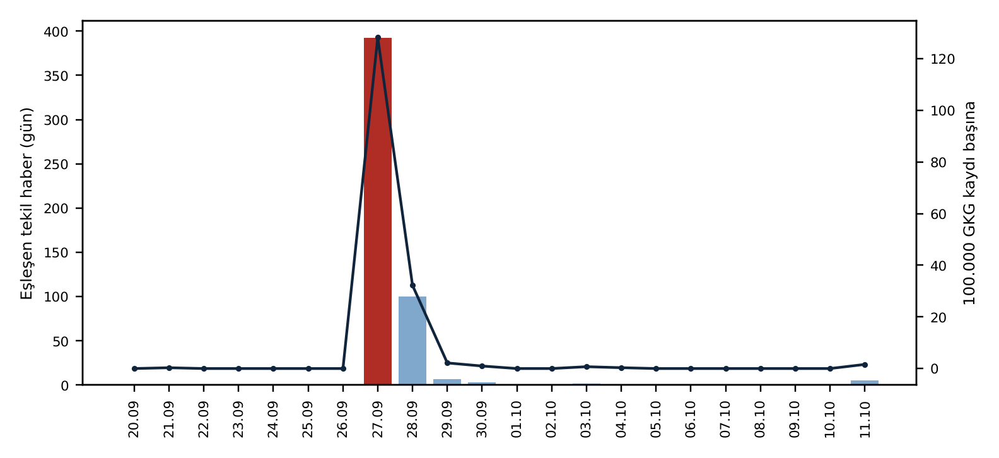

# Özet

Bu makale, Rusya kaynaklı Doppelgänger etki operasyonunun Eylül 2022’de ifşa edilen altyapısını ve ifşanın uluslararası haber görünürlüğünü iki açık veri kümesiyle inceliyor. İlk veri kümesi, Meta’nın 27 Eylül 2022’de yayımladığı koordineli sahte davranış göstergeleridir. Bu kümede 311 benzersiz alan adı bulunuyor. İkincisi, GDELT Küresel Bilgi Grafiği’nin (GKG 2.0) 20 Eylül – 11 Ekim 2022 arasındaki ham arşividir. Bu arşivden 4.209 dosya ve 5.944.850 kayıt taranmış, her dosya GDELT’in yayımladığı MD5 özetiyle doğrulanmıştır. Alan adlarının %95,8’i Meta tarafından Almanya hedefli olarak etiketlenmiştir. Yeniden üretilebilir bir sınıflamaya göre alan adlarının yalnızca %13,8’i gerçek bir haber markasının adını birebir taşıyor, %5,1’i bu adların yazım varyantı. Kalan %81,0, var olmayan “bağımsız yayın” adlarından oluşuyor. Bu adların 174’ü, aynı Almanca ifadenin harfleri yer değiştirilerek üretilmiş yazımlarıdır. Marka taklitleri 27 farklı alan adı uzantısına dağılırken uydurma yayın adlarının %94,4’ü altı ucuz uzantıda toplanmıştır. Haber verisinde iki sabit kuralla 511 tekil haber eşleşmiştir. Rastgele örneklemde isabet %90,6’dır (n = 32; %95 GA 75,8–96,8). Eşleşen haberlerin %96,3’ü 27–28 Eylül’de yayımlanmıştır. Haberlerin %63,6’sı Almanya’yı anmaktadır, ancak yalnızca 29’u (%5,7) Almanya kaynaklıdır. Taranan kayıt sayısına oranlandığında ABD kaynaklarındaki yoğunluk Almanya’nınkinin 1,65 katıdır (%95 GA 1,13–2,41). Bulgular, hibrit müdahalenin “görünmez cephe” olarak nitelenen bilgi boyutunda, kamuoyunun gördüğü şeyin büyük ölçüde operasyonun kendisi yerine ifşası olduğu ve ifşanın hedeflenen toplumun medyasında görece sınırlı kaldığı yönünde betimsel bir tablo ortaya koyuyor.

**Anahtar kelimeler:** hibrit müdahale, dezenformasyon, Doppelgänger, alan adı taklidi, GDELT, haber coğrafyası

# Abstract

This article examines the infrastructure of the Russia-linked Doppelgänger influence operation disclosed in September 2022 and the international news visibility of that disclosure, using two open data sets: Meta’s coordinated inauthentic behaviour indicators of 27 September 2022 (311 unique domains) and the raw GDELT Global Knowledge Graph 2.0 archive for 20 September – 11 October 2022 (4,209 MD5-verified files, 5,944,850 records). Meta labelled 95.8% of the domains as targeting Germany. A reproducible typology shows that only 13.8% of the domains reproduce the exact name of a real news outlet and 5.1% are misspellings of such names; the remaining 81.0% are invented “independent outlet” names, 174 of which are letter-permuted spellings of the same German phrases. Brand imitations are spread over 27 top-level domains, whereas 94.4% of the invented names sit on six low-cost extensions. Two fixed keyword rules matched 511 unique news articles (precision 90.6% in a random sample, n = 32, 95% CI 75.8–96.8). Of these, 96.3% appeared on 27–28 September; 63.6% mention Germany, yet only 29 (5.7%) were published by outlets GDELT locates in Germany. Relative to all scanned records, coverage intensity in US-based outlets was 1.65 times that of German outlets (95% CI 1.13–2.41). The findings describe the “invisible front” of hybrid interference as one in which the public largely encounters the disclosure rather than the operation, and in which the disclosure remained comparatively faint in the targeted society’s own media.

**Keywords:** hybrid interference, disinformation, Doppelgänger, domain impersonation, GDELT, news geography

# 1. Giriş

Rusya’nın Ukrayna’yı işgalinden birkaç ay sonra, 27 Eylül 2022’de iki kurum aynı gün aynı ağı kamuoyuna duyurdu. EU DisinfoLab ve Qurium, Bild, Der Spiegel, The Guardian ve ANSA gibi en az 17 medya markasını taklit eden bir kampanyayı raporladı ve kampanyanın en geç Mayıs 2022’den beri sürdüğünü belirtti (Alaphilippe vd., 2022). Meta aynı gün Rusya kaynaklı bir ağı platformlarından kaldırdığını açıkladı. Şirket ağın öncelikle Almanya’yı, ayrıca Fransa, İtalya, Ukrayna ve Birleşik Krallık’ı hedeflediğini, 60’tan fazla taklit haber sitesi çevresinde kurulduğunu bildirdi (Nimmo ve Agranovich, 2022). Kampanya daha sonra “Doppelgänger” adıyla anıldı. Sonraki iki yılda Fransa, Avrupa Birliği ve ABD, ağı Sosyal Tasarım Ajansı (SDA) ve Structura şirketleriyle ilişkilendiren yaptırım ve el koyma kararları aldı. Alman Dışişleri Bakanlığı 2024’te kampanyanın Almanya’yı hedeflemeyi sürdürdüğünü raporladı (Auswärtiges Amt, 2024).

Doppelgänger hakkındaki bilgimizin büyük kısmı platform açıklamalarına, hükümet raporlarına ve araştırma kuruluşlarının belgelerine dayanıyor. Sızdırılmış SDA belgelerini inceleyen kapsamlı bir değerlendirme bile hakemli dergi makalesi değil, bir araştırma enstitüsü raporudur (Pamment ve Tsurtsumia, 2025). Rusya’nın Avrupa’daki etki faaliyetleri üzerine hakemli çalışmalar ise genellikle istihbarat raporlarının sentezine (Karlsen, 2019), sosyal medya içeriğine (Golovchenko, 2020) ya da devlet medyasının haber çerçevelerine (Watanabe, 2017) odaklanıyor. Platformların yayımladığı gösterge listelerini kayıt düzeyinde inceleyen ve bunu bir ifşanın haber coğrafyasıyla birleştiren çalışmalar sınırlı kalmıştır.

Bu makale iki iz üzerinden ilerliyor. Birinci iz, Meta’nın yayımladığı alan adı göstergeleridir. Bunlar operasyonun nasıl bir adres altyapısı kurduğunu gösterir. İkinci iz, ifşanın uluslararası haber kayıtlarıdır. Bunlar kamuoyunun operasyon hakkında neyi, nerede ve ne kadar süre gördüğünü gösterir. Çalışma üç soruyu yanıtlıyor:

- **AS1.** Yayımlanan göstergeler hangi ülkeleri hedef olarak etiketliyor?
- **AS2.** Alan adları hangi taklit örüntülerini izliyor?
- **AS3.** İfşa, ne zaman ve hangi ülkelerin haber kaynaklarında görünür oldu?

Makalenin katkısı, kayıt düzeyinde yeniden üretilebilir bir alan adı tipolojisi ile MD5 doğrulamalı bir haber arşivi taramasını aynı vakada birleştirmesidir. Çalışma erişim, maruziyet ya da etki ölçmüyor. Bu sınır, bulguların yorumunda belirleyici bir yer tutuyor (bkz. Bölüm 7).

# 2. Kuramsal Çerçeve

## 2.1. Hibrit savaştan hibrit müdahaleye

“Hibrit savaş” terimi Rusya’ya özgü bir kavram olarak doğmadı. Terimin erken kullanımlarından biri, Çeçen ayrılıkçı hareketini inceleyen ve modern ile devlet öncesi toplumsal biçimlerin birleştiği bir savaş tipini tartışan Nemeth’in (2002) yüksek lisans tezidir. Kavramı stratejik literatüre taşıyan Hoffman (2007), konvansiyonel kabiliyetlerin, düzensiz taktiklerin, terörizmin ve suçun aynı muharebe alanında eşzamanlı olarak kaynaştığı savaşları tanımlıyordu. Bu tanımda dezenformasyon çekirdek öğe değildi. Kırım’ın 2014’te ilhakından sonra kavram, askerî olmayan araçları da kapsayan “hibrit tehditler” çerçevesine doğru genişledi. Avrupa Hibrit Tehditlerle Mücadele Mükemmeliyet Merkezi (Hybrid CoE, t.y.) bu tehditleri, demokratik devletlerin sistemik kırılganlıklarını hedefleyen ve tespit ile atıf eşiklerini istismar eden koordineli eylemler olarak tanımlar.

Genişleme ciddi eleştiriler aldı. Renz (2016), Kırım sonrasında “hibrit savaş”ın Rus askerî gücünü anlatan baskın bir etikete dönüştüğünü ve askerî olmayan araçların yeniliğini abarttığını savunur. Fridman (2018), terimin hem Batı’da hem de Rus *gibridnaya voyna* söyleminde siyasallaştığını gösterir. Rus metinlerinde hibrit savaşı yürüten taraf çoğu kez Batı’dır. “Gerasimov doktrini” ifadesini ilk kullanan Galeotti (2018) da etiketi geri çekmiştir. Gerasimov’un 2013 tarihli makalesi bir Rus doktrinini değil, Rus Genelkurmayı’nın Batı’ya atfettiği yöntemleri anlatıyordu. Caliskan (2019), strateji kuramı açısından hibrit savaşın yeni bir savaş biçimi olmadığını, savaşın değişen karakterine dair bir betimleme olduğunu ileri sürer. Türkçe literatürde de kavram, Ukrayna müdahaleleri üzerinden ve çoğunlukla askerî boyutuyla tartışılmıştır (Aras ve Yıldırım, 2022; Özdemir ve Eminoğlu, 2022).

Bu eleştiriler kavramın terk edilmesini değil, daraltılmasını gerektiriyor. Wigell (2019), “hibrit müdahale” kavramını önerir. Ona göre dış aktörler dezenformasyon, örtülü diplomasi ve jeoekonomik araçlarla hedef toplumlarda kamalar açar ve liberal demokrasinin açıklığından yararlanır. Mumford ve Carlucci (2023) ise hibrit savaşın analitik çekirdeğini stratejik belirsizlik olarak tanımlar. Bu makalede “hibrit savaş” ifadesi bu daraltılmış anlamda kullanılıyor. **Hibrit müdahale**, devlet ya da devlet bağlantılı aktörlerin savaş eşiğinin altında kalarak, tespit ve atıf eşiklerini istismar eden, açık toplumların bilgi altyapısındaki güven ilişkilerini hedef alan, koordineli ve inkâr edilebilir askerî olmayan faaliyetleridir. Başlıktaki “görünmez cephe” de bu tanımdan türüyor. Operasyon bilinçli olarak eşiğin altında tutulur. Kamuoyunun büyük bölümü operasyonla doğrudan karşılaşmaz. Karşılaştığı şey, çoğu zaman ifşadır.

Lanoszka (2016), hibrit araçların özellikle Rusça konuşan azınlıkları bulunan ve askerî açıdan kırılgan Doğu Avrupa ülkelerinde işe yarayacağını savunur. Bu argüman, Batı Avrupa’yı hibrit savaşın olağan bir hedefi olarak görmeyi zorlaştırır. Bu makale Lanoszka’nın argümanını bir kapsam koşulu olarak kullanıyor. Almanya’da askerî ya da etnik kaldıraçlar sınırlı olduğundan, bilgi alanındaki inkâr edilebilir faaliyetler müdahalenin başlıca kanalı olarak kalır. Karlsen’in (2019) Batı’daki 15 istihbarat ve güvenlik servisinin yaklaşık 40 adet yıllık raporuna dayanan analizi de Rus etki faaliyetlerinin Avrupa’da asıl olarak toplumları bölmeye ve AB ile NATO’yu zayıflatmaya yöneldiğini gösterir.

## 2.2. Ödünç alınmış güvenilirlik ve alan adı taklidi

Operasyonun “neden”ini stratejik anlatı kavramı açıklar. Devletler, uluslararası düzenin geçmişine ve geleceğine ilişkin ortak bir anlam inşa etmek için anlatılar kurar (Miskimmon vd., 2013). “Nasıl” sorusuna ise yorumlayıcı modeller yanıt verir. Paul ve Matthews (2016) Rus propagandasını yüksek hacimli, çok kanallı, hızlı ve tutarlılığa aldırmayan bir “yalan hortumu” olarak modeller. Bu model kanıtlanmış bir doktrin sayılmaz, ancak çok sayıda kısa ömürlü adresin neden işe koşulduğunu anlamaya yardım eder.

Taklit haber sitelerinin işlevi, Bennett ve Livingston’ın (2018) dezenformasyon tanımında açıkça görülür. Bu tanıma göre dezenformasyon, siyasal amaçlarla haber öyküsü ya da belgesel biçimlerini taklit eden kasıtlı yanlışlardır. Wardle ve Derakhshan (2017), bilgi düzensizliğini oluşturma, üretim ve dağıtım evreleri üzerinden inceler. Klon bir haber sitesi bu çerçevede hem üretim hem de dağıtım altyapısıdır. Lazer vd. (2018) yalan haberi, haber medyasının biçimini taklit eden ama onun örgütsel süreçlerinden yoksun içerik olarak tanımlar. Bu tanım, bir markanın görünüşünü kopyalayan alan adlarının neden etkili olabileceğini açıklar. Okur, kaynağın güvenilirliğini çoğu zaman tanıdık bir marka ve görünüm gibi kısa yollarla değerlendirir.

Bilgisayar güvenliği literatürü, benzer alan adlarını sistematik olarak sınıflandırır. Tian vd. (2018), yazım hatası (*typosquatting*), birleştirme (*combosquatting*), homograf, bit değişimi ve yanlış uzantı (*wrongTLD*) türlerini ayırır. Marka adı aynen korunup yalnızca uzantı değiştiğinde ortaya çıkan tür, wrongTLD’dir. Korczyński vd. (2018), alan adı kötüye kullanımının yeni genel uzantılarda yoğunlaştığını ve kayıt kurallarının sıkılaştığı uzantılarda azaldığını gösterir. Bu iki çalışma, AS2 için iki beklenti doğurur. Birincisi, taklitlerin önemli bir kısmının marka adını koruyup uzantıyı değiştirmesidir. İkincisi, ucuz ve gevşek kurallı uzantıların tercih edilmesidir.

## 2.3. İfşa, görünürlük ve algı korsanlığı

Bir operasyonun ifşası, kendi başına bir iletişim olayıdır. Haber akışı literatürü, uluslararası haberin seçkin ülkeler ve büyük ajanslar etrafında yoğunlaştığını uzun süredir gösteriyor (Galtung ve Ruge, 1965). Kwak ve An (2014), GDELT verisiyle afet haberlerinde güçlü bir bölgeselcilik bulmuştur. Bu bulgular AS3 için şu beklentiyi doğurur: İfşa kısa ömürlü, tetikleyici olaya bağlı ve büyük ajans ağları üzerinden dolaşan bir görünürlük kazanır.

İfşanın görünürlüğü, operasyonun başarısı anlamına gelmiyor. Eady vd. (2023), 2016 ABD seçiminde Rus İnternet Araştırma Ajansı içeriğine maruziyetin kullanıcıların %1’inde yoğunlaştığını ve tutum ya da oy davranışıyla ilişkisinin saptanmadığını bulmuştur. Sızdırılmış SDA belgeleri ise operatörlerin Batı medyasındaki haberleri müşterilerine başarı kanıtı olarak sunduğunu göstermektedir (Pamment ve Tsurtsumia, 2025). Bu durum, platform araştırmacılarının “algı korsanlığı” dediği olguya karşılık gelir: operatörün olduğundan daha etkili görünmeye çalışması. Jungherr ve Rauchfleisch (2024) da alarmist dezenformasyon söyleminin, kendi başına, demokrasiden memnuniyeti düşürebildiğini deneysel olarak göstermiştir. Bu nedenle ifşanın nerede ve ne ölçüde görünür olduğu, hibrit müdahalenin bilgi boyutunu anlamak için ayrı bir ölçüm konusudur.

# 3. Vaka: Doppelgänger, 2022–2025

Kampanya, 27 Eylül 2022’de aynı gün yapılan iki ifşayla görünür oldu (Alaphilippe vd., 2022; Nimmo ve Agranovich, 2022). Meta o tarihte ağı belirli bir kuruluşa atfetmedi. Atıf sonraki aylarda netleşti. Meta 2023’te ağı SDA ve Structura ile ilişkilendirdi, ardından Fransa, Avrupa Birliği ve ABD bu şirketlere yönelik yaptırım ve el koyma kararları aldı. Alman Dışişleri Bakanlığı, Aralık 2023 – Ocak 2024 döneminde 50.000’den fazla sahte X hesabının 1,8 milyondan fazla Almanca gönderi yayımladığını raporladı (Auswärtiges Amt, 2024). Pamment ve Tsurtsumia (2025), 3.000’den fazla sızdırılmış SDA belgesine dayanarak kampanyanın etkisinin abartıldığı sonucuna varmıştır.

Bu kronoloji, incelenen verinin niteliğini belirler. 2022 gösterge listesi, operasyonun ilk evresine ait ve platform tarafından seçilerek yayımlanmış bir anlık görüntüdür. Rogers ve Righetti (2025), Meta’nın koordineli sahte davranış tanımının zaman içinde daraldığını göstermiştir. Bu nedenle liste operasyonun bir örneklemi sayılmaz. Liste, platformun 2022’deki uygulama kararlarının bir kaydıdır ve operasyonun alt sınırını gösterir.

# 4. Veri ve Yöntem

## 4.1. Meta gösterge verisi

Meta’nın tehdit araştırması deposundaki 27 Eylül 2022 tarihli gösterge dosyası sabit bir commit bağlantısından indirildi ve dosyanın SHA-256 özeti kaydedildi (Meta, 2022). Dosyada 350 kayıt bulunuyor. Bunların 313’ü alan adı türündedir. Küçük harfe dönüştürülmüş tam alan adı üzerinde tekilleştirme sonrasında iki yinelenen kayıt çıkarıldı ve 311 benzersiz alan adı elde edildi. Dosyadaki 22 Facebook bağlantısı ve 15 Telegram bağlantısı farklı analiz birimleri olduğu için paydaya katılmadı. Hedef ülke, kaynağın yorum alanındaki etiketten alındı. Uzantıdan, IP adresinden ya da barındırma bilgisinden ülke çıkarımı yapılmadı. Kayıtların tamamında tarih alanı aynıdır (27 Eylül 2022). Bu yüzden faaliyetin zaman içindeki seyrine ilişkin bir çıkarım yapılmadı.

## 4.2. Alan adı tipolojisinin operasyonelleştirilmesi

Her alan adının ilk DNS etiketi (ilk noktadan önceki dize) ve son DNS etiketi (son noktadan sonraki dize) ayrıştırıldı. İlk etiketler üç sınıfa ayrıldı. Sınıflama, 15 yayın kuruluşunun alan adı etiketlerinden oluşan sabit bir listeye dayanıyor. Liste, vaka raporlarında taklit edildiği belirtilen markalardan (Alaphilippe vd., 2022; Nimmo ve Agranovich, 2022) ve gösterge listesinde tanınabilir bir haber markası adı taşıyan etiketlerden derlendi; listenin tamamı veri deposunda yer alıyor:

- **Marka birebir:** İlk etiket, gerçek bir yayın kuruluşunun etiketiyle birebir aynıdır (örneğin *spiegel*). Uzantı farklı olduğunda bu, Tian vd.’nin (2018) wrongTLD türüne karşılık gelir.
- **Marka varyantı:** İlk etiket, bir yayın kuruluşu etiketine Damerau–Levenshtein uzaklığı ölçütüyle yakındır (örneğin *spiegeli*, *t-onlinr*). Eşik, en fazla iki düzenleme ve marka etiketinin uzunluğunun yarısından az olacak şekilde belirlendi.
- **Uydurma yayın adı:** Diğer bütün etiketler. Bu adlar, var olan bir haber markasına ait değildir.

Uydurma yayın adları içinde, harf çoklu kümesi (sıralanmış harfleri) aynı olan farklı yazımlar “harf karışımı ailesi” olarak gruplandı. Örneğin *dassprachrohr*, *dassprahcrohr* ve *dassrpahcorhr* aynı ailededir. Kural yalnızca birebir harf eşitliğine dayanır. Bu nedenle sesli harfi düşürülmüş yazımlar (örneğin *dknuzsrntch*) ayrı tutulur ve aile sayısı muhafazakâr bir alt sınırdır.

## 4.3. GDELT GKG ham arşivi

Haber verisi için GDELT’in canlı arama arayüzü yerine, GDELT literatüründe kullanılan Küresel Bilgi Grafiği 2.0 ham arşivi kullanıldı (Leetaru ve Schrodt, 2013; The GDELT Project, 2015). Bu tercihin iki gerekçesi var. Arama arayüzü resmî olarak yalnızca son üç ayı kapsıyor. Ham arşiv ise sabit dosyalardan oluştuğu için başkaları tarafından birebir yeniden taranabiliyor. 20 Eylül – 11 Ekim 2022 arasındaki bütün 15 dakikalık İngilizce ve çeviri (translingual) dosyaları, GDELT’in yayımladığı dosya listelerinden belirlendi. Bu pencere için listelerde 4.209 dosya yer alıyor (İngilizce akış 2.112, çeviri akışı 2.097). Kesintisiz bir yayında beklenecek sayı 4.224’tür. Aradaki 15 dosya GDELT’in listesinde yoktur. İndirilen her dosyanın boyutu ve MD5 özeti, GDELT’in listede verdiği değerlerle karşılaştırıldı. 4.209 dosyanın tamamı eşleşti ve toplam 5.944.850 haber kaydı tarandı.

Haberin yayımlandığı ülke, GDELT’in alan adı–ülke eşleştirme dosyasından alındı (The GDELT Project, 2018). GDELT bu eşleştirmede bir yayın kuruluşunu, haberlerinde en sık andığı ülkeye atar. Bu nedenle değişken, “GDELT’in çıkarımına göre yayın ülkesi” olarak okunmalıdır. Değişken, okurun bulunduğu ülkeyi göstermez. Haberde anılan yerler, aynı kayıtların V2Locations alanından alındı. Her gün ve her yayın ülkesi için taranan bütün kayıtlar payda olarak saklandı.

## 4.4. Eşleşme kuralları ve geçerlilik denetimi

Haberler, sayfa başlığı ve URL üzerinde çalışan iki sabit kuralla seçildi. Kural R1, “doppelgänger” yazımlarından birinin bir Rusya bağlamıyla birlikte geçmesini arar. Rusya bağlamı, başlıkta ya da URL’de bir Rusya teriminin bulunması veya makalenin GKG konumları arasında Rusya’nın yer almasıdır. Kural R2, Meta, Facebook ya da Instagram adının bir Rusya terimiyle ve ağ, sahte, propaganda, dezenformasyon ya da kaldırma anlamına gelen çok dilli bir terimle birlikte geçmesini arar. Eşleşmeler URL düzeyinde tekilleştirildi.

Kuralların isabeti, sabit tohumla (2022) çekilen rastgele bir örneklemde ölçüldü. R2 için 30 başlık çekildi, R1 yalnızca iki eşleşme ürettiği için tamamı örnekleme alındı. Her başlık, Meta’nın Eylül 2022 kaldırması ya da Doppelgänger kampanyasıyla ilgili olup olmadığına göre kodlandı. Wang vd.’nin (2016) GDELT olay verisinin isabetine ilişkin uyarısı, bu denetimin gerekçesidir. Duyarlılık, yani kuralların kaçırdığı ilgili haberlerin oranı, ölçülmedi.

## 4.5. İstatistiksel yöntem

Oranlar için Wilson %95 güven aralıkları hesaplandı. Yayın ülkesine göre yoğunluk, eşleşen haber sayısının o ülkeden taranan kayıt sayısına oranı olarak, 100.000 kayıt başına raporlandı. Bu oranlar için kesin Poisson güven aralıkları kullanıldı. ABD ile Almanya arasındaki yoğunluk oranı, logaritmik ölçekte normal yaklaşımla hesaplandı. Ajans haberlerinin yeniden yayımlanmasının etkisini görmek için sayımlar haber (URL), yayın kuruluşu (alan adı) ve tekil başlık düzeylerinde ayrı ayrı verildi. Bütün sayılar, makalenin veri deposundaki betiklerle ham dosyalardan yeniden hesaplanabiliyor (bkz. Veri ve Kod Erişilebilirliği).

# 5. Bulgular

## 5.1. Hedefleme (AS1)

311 alan adının 298’i (%95,8) Meta tarafından Almanya hedefli olarak etiketlenmiştir. Diğer etiketler Birleşik Krallık (4), Letonya (3), Fransa (2), İtalya (2), Ukrayna (1) ve birden fazla ülke (1) şeklinde dağılıyor. Bu yoğunlaşma, Meta’nın ve EU DisinfoLab’in Almanya’yı öncelikli hedef olarak tanımlamasıyla uyumludur. Bununla birlikte Meta’nın açıklaması Fransa, İtalya, Ukrayna ve Birleşik Krallık’ı da sayıyor. Göstergelerdeki dağılım, platformun yayımladığı alan adı altyapısının dağılımıdır ve operasyonun bütün faaliyetini temsil etmeyebilir.

## 5.2. Alan adı altyapısı (AS2)

Tablo 1, tipolojinin sonuçlarını gösteriyor.

**Tablo 1.** Meta gösterge listesindeki alan adlarının tipolojisi (N = 311)

| Sınıf | Alan adı | Pay | Almanya etiketli | En sık altı uzantıda |
|---|---:|---:|---:|---:|
| Marka birebir | 43 | %13,8 | 34 | 2 |
| Marka varyantı | 16 | %5,1 | 14 | 0 |
| Uydurma yayın adı | 252 | %81,0 | 250 | 238 |
| Toplam | 311 | %100,0 | 298 | 240 |

*Not.* En sık altı son DNS etiketi: *online* (53), *website* (50), *site* (46), *space* (42), *pw* (28), *fun* (21).

Birebir marka taklitleri 13 yayın kuruluşuna dağılıyor: Der Spiegel (9), Bild (8), Süddeutsche Zeitung (4), Die Welt (4), Daily Mail (3), Delfi (3), FAZ (3), nd (3), Tagesspiegel (2), ANSA (1), La Repubblica (1), t-online (1) ve The Guardian (1). Bu 43 alan adı 27 farklı uzantıya yayılmıştır ve hiçbir uzantıda beşten fazla birebir taklit bulunmuyor (örneğin *bild.asia*, *bild.expert*, *ansa.ltd*). Marka varyantları, adın bir harfinin değiştirilmesi ya da eklenmesiyle oluşuyor (*spiegeli*, *spiegelr*, *t-onlinl*, *t-onlinr*, *tonline*, *20minuts*, *rbk*).

Altyapının büyük bölümü ise var olmayan yayınların adlarından oluşuyor. 252 uydurma yayın adı 73 farklı ilk etiket taşıyor. Bu etiketlerin çoğu, “denk zuerst nach” (önce düşün), “Wahrheit” (hakikat), “offene Meinung” (açık fikir), “lerne zu denken” (düşünmeyi öğren), “Offenbarung” (ifşa) ya da “das Sprachrohr” (sözcü) gibi Almanca ifadelerin harfleri karıştırılmış yazımlarıdır. Birebir harf eşitliği kuralıyla 45 etiket 19 harf karışımı ailesi oluşturuyor ve bu aileler 174 alan adını kapsıyor. Uydurma yayın adlarının 238’i (%94,4) en sık altı uzantıda toplanıyor. Bu uzantılardaki 240 alan adının yalnızca ikisi bir markayı birebir taklit ediyor.

Bu sonuç, Bölüm 2.2’deki ilk beklentiyi büyük ölçüde karşılamıyor. Marka adını koruyup uzantıyı değiştiren wrongTLD türü altyapının yalnızca küçük bir kesimidir. Asıl strateji, sahte bir “bağımsız Alman yayını” kimliği üretmek ve bu kimliği harf karışımı yazımlarla çok sayıda ucuz adrese çoğaltmaktır. İkinci beklenti ise doğrulanıyor: Çoğaltılan adresler, Korczyński vd.’nin (2018) kötüye kullanımın yoğunlaştığını gösterdiği yeni ve ucuz uzantılarda toplanıyor. Fiyat verisi incelenmediği için “ucuz” nitelemesi bir çıkarımdır.

## 5.3. İfşanın zamanı (AS3)

İki kural 511 tekil haberle eşleşti. Bunların 509’u R2’den, 2’si R1’den geliyor. Rastgele örneklemde 32 başlığın 29’u ilgiliydi. İsabet %90,6’dır (Wilson %95 GA 75,8–96,8). İlgisiz bulunan üç başlık, Putin’in “dublörleri” üzerine bir haber, Apple’ın VK uygulamasını mağazasından kaldırması ve Finlandiya sınırına ilişkin bir haberdir. R1’in iki eşleşmesinden biri ilgisizdir. Kampanya adının 2022 haberlerinde neredeyse hiç kullanılmadığı görülüyor.

Şekil 1, eşleşmelerin günlere dağılımını gösteriyor. 27 Eylül’de 392, 28 Eylül’de 100 haber yayımlanmıştır. Bu iki gün, eşleşmelerin %96,3’ünü oluşturuyor. 27 Eylül’den önce yalnızca bir haber var, 28 Eylül’den sonraki 13 günde ise toplam 18 haber bulunuyor. Taranan bütün kayıtlara oranlanmış seri aynı biçimi izliyor. Bu nedenle zirve, o günlerdeki genel haber hacminden kaynaklanmıyor.

511 haber yalnızca 145 farklı başlık taşıyor ve 352 farklı yayın kuruluşundan geliyor. Başlıkların en sık tekrarlananları büyük ajans haberleridir. Örneğin “Meta disables Russian propaganda network targeting Europe” başlığı, çok sayıda yerel sitede aynen yayımlanmıştır. Haberlerin %81,4’ü İngilizcedir, Almanca haberler 35 tanedir.

## 5.4. İfşanın coğrafyası (AS3)

Tablo 2, eşleşen haberleri GDELT’in çıkarımına göre yayın ülkesine ayırıyor.

**Tablo 2.** Yayın ülkesine göre eşleşen haberler ve taranan kayıtlara göre yoğunluk

| Yayın ülkesi | Haber | Yayın kuruluşu | Tekil başlık | Taranan kayıt | 100.000 kayıt başına (%95 GA) |
|---|---:|---:|---:|---:|---|
| ABD | 373 | 230 | 63 | 1.469.262 | 25,39 (22,88–28,10) |
| Almanya | 29 | 29 | 13 | 188.558 | 15,38 (10,30–22,09) |
| İtalya | 13 | 9 | 11 | 240.258 | 5,41 (2,88–9,25) |
| Rusya | 6 | — | — | 207.379 | 2,89 (1,06–6,30) |
| Fransa | 4 | — | — | 145.528 | 2,75 (0,75–7,04) |
| Birleşik Krallık | 6 | — | — | 293.147 | 2,05 (0,75–4,45) |

*Not.* 36 yayın ülkesi saptandı. 8 haberin alan adı GDELT eşleştirme dosyasında bulunmuyor. Yayın kuruluşu ve başlık sayıları yalnızca ilk üç ülke için verildi.

Haberlerin %73,0’ı ABD’de, %5,7’si Almanya’da yayımlanmıştır. GDELT’in ABD kaynaklarını çok daha yoğun izlediği göz önüne alınarak hesaplanan oranlı ölçüde Almanya ikinci sıraya çıkıyor. ABD’deki yoğunluk Almanya’dakinin 1,65 katıdır (%95 GA 1,13–2,41). ABD’deki hacmin önemli bir kısmı ajans haberlerinin yeniden yayımlanmasından kaynaklanıyor. 373 ABD haberi yalnızca 63 farklı başlık taşıyor. Almanya’daki 29 haber ise 29 ayrı yayın kuruluşundan ve 13 farklı başlıktan geliyor. Tekil başlık düzeyinde ABD ile Almanya arasındaki fark, haber düzeyindekinden belirgin biçimde küçüktür.

Haberlerde anılan yerler farklı bir tablo çiziyor. Haberlerin %63,6’sı Almanya’yı, %57,1’i Fransa’yı ve İtalya’yı, %46,2’si Birleşik Krallık’ı anıyor (Şekil 2). Hedeflenen ülkeler haberin konusudur. Haberin üretildiği yer ise ağırlıkla ABD ve İngilizce ajans ekosistemidir.

# 6. Tartışma

İlk bulgu, hedefleme önceliğine ilişkindir. Almanya’ya ayrılan altyapı payı, Doppelgänger raporlarındaki nitel vurguyla uyumlu. Lanoszka’nın (2016) kapsam koşulu açısından bakıldığında da anlamlı. Askerî ya da etnik kaldıracı sınırlı olan büyük bir Batı Avrupa toplumunda müdahale, bilgi altyapısındaki güven ilişkilerine yönelmiş görünüyor. Bu pay bir yatırım ve öncelik göstergesidir. Alan adı sayısı, Almanya’daki okurların bu adreslerle ne ölçüde karşılaştığını göstermez.

İkinci bulgu, “ödünç alınmış güvenilirlik” kavramının vakaya nasıl uygulanacağını değiştiriyor. Gerçek markaları birebir kopyalayan adresler var, ancak altyapının yalnızca beşte birini oluşturuyorlar ve çok sayıda uzantıya dağılmış durumdalar. Altyapının asıl gövdesi, var olmayan “bağımsız” Alman yayınlarıdır. Bu adreslerin adları “hakikat”, “açık fikir” ya da “önce düşün” gibi alternatif medya söylemini çağrıştıran ifadelerden türetilmiştir. Bennett ve Livingston’ın (2018) tanımındaki “haber biçimini taklit etme” burada iki farklı biçimde ortaya çıkıyor. Bir kısım adres tanınmış markaların itibarını ödünç alıyor. Büyük kısmı ise ana akım medyaya güvenmeyen okurlara hitap eden bir “bağımsız yayıncılık” kimliğini taklit ediyor. Harf karışımı yazımlar, aynı kimliğin engellemelere karşı çok sayıda adrese hızla çoğaltıldığını düşündürüyor. Paul ve Matthews’ın (2016) yüksek hacim ve çok kanal vurgusuyla uyumlu bir altyapı mantığı bu. Ancak eldeki veriyle adreslerin hangi sırayla ve hangi amaçla kaydedildiği belirlenemiyor.

Üçüncü bulgu, “görünmez cephe” metaforunu sınanabilir bir önermeye dönüştürüyor. İfşa, iki gün süren ve büyük ölçüde ABD ile İngilizce ajans ağı üzerinden dolaşan bir haber olayı olarak görünür oldu. Haberler Almanya’yı sıkça anarken Almanya kaynaklı haber sayısı düşük kaldı. Bu, hedeflenen kamuoyunun ifşayı kendi medyasında görece az gördüğü yönünde bir hipotezdir. Bu yorum tekil başlık düzeyinde zayıflıyor. Ayrıca kuralların Almanca haberleri ne ölçüde kaçırdığı ölçülmedi. Bu iki durum, bulgunun kanıt olarak değil hipotez olarak sunulmasını gerektiriyor. Kwak ve An’ın (2014) bölgesel haber coğrafyası bulgusuyla karşılaştırıldığında vaka ilginç bir sapma gösteriyor. Avrupa’yı hedefleyen bir operasyonun ifşası, Avrupa medyasından çok küresel İngilizce medyada yoğunlaşmıştır.

Bu tablo algı korsanlığı tartışmasıyla birlikte okunmalı. İfşanın uluslararası haber değeri, operatörün müşterisine gösterebileceği bir “başarı” kanıtına dönüşebilir (Pamment ve Tsurtsumia, 2025). İfşa haberlerinin dili de yan etkiler doğurabilir (Jungherr ve Rauchfleisch, 2024). Hibrit müdahalenin bilgi boyutunda kamuoyunun gördüğü şeyin büyük ölçüde ifşa olduğu düşünülürse, ifşanın nerede, ne kadar süre ve hangi dille dolaştığı da bu müdahalenin bir parçası olarak incelenmelidir.

# 7. Sınırlılıklar

Meta’nın listesi, platformun tespit ve yayımlama kararlarının ürünüdür ve operasyonun alt sınırını gösterir. Almanya etiketi Meta’nın sınıflandırmasıdır ve taklit edilen markanın ülkesini yansıtıyor olabilir. Operatörlerin SDA ve Structura olarak tanımlanması, 2022 sonrasında yapılmış geriye dönük bir atıftır.

Tipoloji, kuruluş listesine bağlıdır. Listede bulunmayan bir markanın taklidi “uydurma yayın adı” sınıfına düşebilir. Harf karışımı ailesi kuralı yalnızca birebir harf eşitliğine dayandığı için aile sayısı bir alt sınırdır. Alan adlarının kayıt tarihleri, fiyatları ve barındırma bilgileri incelenmedi.

GDELT yalnızca izlediği kaynakları kapsıyor ve bu kapsam ülkeler ile diller arasında eşit değil (Hammond ve Weidmann, 2014; Hoffmann vd., 2022). Yayın ülkesi GDELT’in 2018 tarihli bir çıkarımıdır ve okurun ülkesini göstermez. İsabet örneklemi küçüktür (n = 32) ve güven aralığı geniştir. Kodlama tek bir kodlayıcı tarafından yapıldı. Kuralların kaçırdığı haberler ölçülmedi. Eşleşme yalnızca başlık ve URL üzerinden yapıldığı için haber metninde konuyu işleyen ama başlığında anahtar sözcük bulunmayan haberler kapsam dışında kaldı.

Son olarak çalışma erişim, maruziyet, etkileşim ya da etki ölçmüyor. Meta’nın 2022 raporu, büyük bir altyapıya karşılık küçük bir takipçi kitlesi bildiriyor (Nimmo ve Agranovich, 2022). Bu bilgi, bulguların altyapı ve görünürlük düzeyinde kalması gerektiğini bir kez daha gösteriyor.

# 8. Sonuç

Doppelgänger’in 2022’de ifşa edilen altyapısı Almanya’ya yoğunlaşmış, ancak çoğunlukla tanınmış markaların değil, uydurma “bağımsız” yayınların adlarından oluşmuştur. Bu adlar harf karışımı yazımlarla ucuz uzantılarda çoğaltılmıştır. İfşanın kendisi ise iki gün süren ve ağırlıkla ABD ile İngilizce ajans ağı üzerinden dolaşan bir haber olayı olarak görünür olmuştur. Hedeflenen ülke haberlerde sıkça anılmış, ancak kendi medyasında görece sınırlı yer bulmuştur. Bu bulgular, hibrit müdahalenin “görünmez cephe” olarak adlandırılan bilgi boyutunu ölçülebilir iki ize bağlıyor: operasyonun bıraktığı altyapı ve ifşanın dolaştığı haber coğrafyası.

Sonraki çalışmalar için üç adım öne çıkıyor. Birincisi, 145 tekil başlığın tamamının kör bir ikinci kodlayıcıyla kodlanması ve Almanca akışta kaçırılan haberlerin ölçülmesidir. İkincisi, alan adlarının kayıt tarihleri ve barındırma verileriyle harf karışımı ailelerinin zamanlamasının incelenmesidir. Üçüncüsü, AB Dijital Hizmetler Yasası’nın 40. maddesi kapsamındaki veri erişimi ve web izleme panelleri aracılığıyla, bu adreslerle gerçek okurların ne ölçüde karşılaştığının ölçülmesidir.

# Veri ve Kod Erişilebilirliği

Analizde kullanılan bütün veriler ve kodlar https://github.com/erdemkulaclii/SUNUM adresindeki depoda yer almaktadır. Depoda Meta gösterge dosyasının kopyası ve SHA-256 özeti, alan adı tipolojisinin kuralları, GDELT dosya listesi ve MD5 doğrulama kayıtları, eşleşen haberler ile günlük ve ülke paydaları, isabet örneklemi ve kodlamaları bulunmaktadır. Makalede raporlanan her sayıyı ham dosyalardan yeniden hesaplayan betik ile bu sayıların makale metniyle eşleştiğini denetleyen otomatik testler de depoda yer almaktadır.

# Yapay Zekâ Kullanım Beyanı

Bu çalışmanın hazırlanmasında bir yapay zekâ asistanından (Anthropic Claude) yararlanılmıştır. Asistan veri toplama ve analiz kodlarının yazılmasında, isabet örnekleminin ilk kodlamasında, literatür taramasında ve metnin ilk taslağında kullanılmıştır. Kodlar ve sayılar otomatik testlerle ham verilere karşı denetlenmiştir. Kaynakların künyeleri yayıncı ve depo kayıtlarıyla karşılaştırılmıştır. Bulguların yorumu ve metnin son hâli yazarın sorumluluğundadır.

# Kaynakça

Alaphilippe, A., Machado, G., Miguel, R., & Poldi, F. (2022, September 27). *Doppelganger: Media clones serving Russian propaganda*. EU DisinfoLab. https://www.disinfo.eu/doppelganger/

Aras, H., & Yıldırım, Y. (2022). Rusya’nın 2014 Ukrayna Krizi’ndeki hibrit savaş stratejisi. *Yönetim ve Ekonomi, 29*(3), 499–516.

Auswärtiges Amt. (2024, June 5). *Germany targeted by the pro-Russian disinformation campaign “Doppelgänger”* [Technical report]. https://www.auswaertiges-amt.de/resource/blob/2682484/2da31936d1cbeb9faec49df74d8bbe2e/technischer-bericht-desinformationskampagne-doppelgaenger-1--data.pdf

Bennett, W. L., & Livingston, S. (2018). The disinformation order: Disruptive communication and the decline of democratic institutions. *European Journal of Communication, 33*(2), 122–139. https://doi.org/10.1177/0267323118760317

Caliskan, M. (2019). Hybrid warfare through the lens of strategic theory. *Defense & Security Analysis, 35*(1), 40–58. https://doi.org/10.1080/14751798.2019.1565364

Eady, G., Paskhalis, T., Zilinsky, J., Bonneau, R., Nagler, J., & Tucker, J. A. (2023). Exposure to the Russian Internet Research Agency foreign influence campaign on Twitter in the 2016 US election and its relationship to attitudes and voting behavior. *Nature Communications, 14*, Article 62. https://doi.org/10.1038/s41467-022-35576-9

Fridman, O. (2018). *Russian “hybrid warfare”: Resurgence and politicisation*. Oxford University Press.

Galeotti, M. (2018, March 5). I’m sorry for creating the “Gerasimov doctrine”. *Foreign Policy*. https://foreignpolicy.com/2018/03/05/im-sorry-for-creating-the-gerasimov-doctrine/

Galtung, J., & Ruge, M. H. (1965). The structure of foreign news: The presentation of the Congo, Cuba and Cyprus crises in four Norwegian newspapers. *Journal of Peace Research, 2*(1), 64–90. https://doi.org/10.1177/002234336500200104

Golovchenko, Y. (2020). Measuring the scope of pro-Kremlin disinformation on Twitter. *Humanities and Social Sciences Communications, 7*. https://doi.org/10.1057/s41599-020-00659-9

Hammond, J., & Weidmann, N. B. (2014). Using machine-coded event data for the micro-level study of political violence. *Research & Politics, 1*(2). https://doi.org/10.1177/2053168014539924

Hoffman, F. G. (2007). *Conflict in the 21st century: The rise of hybrid wars*. Potomac Institute for Policy Studies.

Hoffmann, M., Santos, F. G., Neumayer, C., & Mercea, D. (2022). Lifting the veil on the use of big data news repositories: A documentation and critical discussion of a protest event analysis. *Communication Methods and Measures, 16*(4), 283–302. https://doi.org/10.1080/19312458.2022.2128099

Hybrid CoE. (t.y.). *Hybrid threats as a concept*. European Centre of Excellence for Countering Hybrid Threats. https://www.hybridcoe.fi/hybrid-threats/

Jungherr, A., & Rauchfleisch, A. (2024). Negative downstream effects of alarmist disinformation discourse: Evidence from the United States. *Political Behavior, 46*(4), 2123–2143. https://doi.org/10.1007/s11109-024-09911-3

Karlsen, G. H. (2019). Divide and rule: Ten lessons about Russian political influence activities in Europe. *Palgrave Communications, 5*. https://doi.org/10.1057/s41599-019-0227-8

Korczyński, M., Wullink, M., Tajalizadehkhoob, S., Moura, G. C. M., Noroozian, A., Bagley, D., & Hesselman, C. (2018). Cybercrime after the sunrise: A statistical analysis of DNS abuse in new gTLDs. In *Proceedings of the 2018 Asia Conference on Computer and Communications Security* ACM. https://doi.org/10.1145/3196494.3196548

Kwak, H., & An, J. (2014). A first look at global news coverage of disasters by using the GDELT dataset. In L. M. Aiello & D. McFarland (Eds.), *Social informatics: SocInfo 2014* (pp. 300–308). Springer. https://doi.org/10.1007/978-3-319-13734-6_22

Lanoszka, A. (2016). Russian hybrid warfare and extended deterrence in eastern Europe. *International Affairs, 92*(1), 175–195. https://doi.org/10.1111/1468-2346.12509

Lazer, D. M. J., Baum, M. A., Benkler, Y., Berinsky, A. J., Greenhill, K. M., Menczer, F., Metzger, M. J., Nyhan, B., Pennycook, G., Rothschild, D., Schudson, M., Sloman, S. A., Sunstein, C. R., Thorson, E. A., Watts, D. J., & Zittrain, J. L. (2018). The science of fake news. *Science, 359*(6380), 1094–1096. https://doi.org/10.1126/science.aao2998

Leetaru, K., & Schrodt, P. A. (2013, April). *GDELT: Global data on events, location, and tone, 1979–2012* [Paper presentation]. International Studies Association Annual Convention, San Francisco, CA, United States.

Meta. (2022, September 27). *2022_09_removing_coordinated_inauthentic_behavior_from_china_and_russia.csv* [Data set]. GitHub. https://github.com/facebook/threat-research/blob/2d664e985e55fb754de7b1175f713e11f73cf8c8/indicators/csv/2022_09_removing_coordinated_inauthentic_behavior_from_china_and_russia.csv

Miskimmon, A., O’Loughlin, B., & Roselle, L. (2013). *Strategic narratives: Communication power and the new world order*. Routledge. https://doi.org/10.4324/9781315871264

Mumford, A., & Carlucci, P. (2023). Hybrid warfare: The continuation of ambiguity by other means. *European Journal of International Security, 8*(2), 192–206. https://doi.org/10.1017/eis.2022.19

Nemeth, W. J. (2002). *Future war and Chechnya: A case for hybrid warfare* [Master’s thesis, Naval Postgraduate School]. https://calhoun.nps.edu/handle/10945/5865

Nimmo, B., & Agranovich, D. (2022, September 27). *Removing coordinated inauthentic behavior from China and Russia*. Meta. https://about.fb.com/news/2022/09/removing-coordinated-inauthentic-behavior-from-china-and-russia/

Özdemir, Ş., & Eminoğlu, A. (2022). Yeni nesil savaş: Rusya’nın Donbas’ta uyguladığı hibrit savaş yöntemi. *Hitit Sosyal Bilimler Dergisi*. https://doi.org/10.17218/hititsbd.1066684

Pamment, J., & Tsurtsumia, D. (2025). *Beyond Operation Doppelgänger: A capability assessment of the Social Design Agency*. Psychological Defence Research Institute, Lund University; Swedish Psychological Defence Agency.

Paul, C., & Matthews, M. (2016). *The Russian “firehose of falsehood” propaganda model: Why it might work and options to counter it* (Perspective PE-198). RAND Corporation. https://doi.org/10.7249/PE198

Renz, B. (2016). Russia and “hybrid warfare”. *Contemporary Politics, 22*(3), 283–300. https://doi.org/10.1080/13569775.2016.1201316

Rogers, R., & Righetti, N. (2025). Coordinated inauthentic behaviour on Facebook? A typology of manufactured attention. *Platforms & Society*. https://doi.org/10.1177/29768624251369784

The GDELT Project. (2015). *GDELT 2.0 Global Knowledge Graph* [Data set; raw 15-minute files, 20 September–11 October 2022]. Retrieved October 31, 2026, from https://www.gdeltproject.org/data.html

The GDELT Project. (2018). *Mapping the media: A geographic lookup of GDELT’s sources* [Data set and blog post]. https://blog.gdeltproject.org/?p=4818

Tian, K., Jan, S. T. K., Hu, H., Yao, D., & Wang, G. (2018). Needle in a haystack: Tracking down elite phishing domains in the wild. In *Proceedings of the Internet Measurement Conference 2018* ACM. https://doi.org/10.1145/3278532.3278569

Wang, W., Kennedy, R., Lazer, D., & Ramakrishnan, N. (2016). Growing pains for global monitoring of societal events. *Science, 353*(6307), 1502–1503.

Wardle, C., & Derakhshan, H. (2017). *Information disorder: Toward an interdisciplinary framework for research and policy making* (DGI(2017)09). Council of Europe.

Watanabe, K. (2017). Measuring news bias: Russia’s official news agency ITAR-TASS’ coverage of the Ukraine crisis. *European Journal of Communication, 32*(3), 224–241. https://doi.org/10.1177/0267323117695735

Wigell, M. (2019). Hybrid interference as a wedge strategy: A theory of external interference in liberal democracy. *International Affairs, 95*(2), 255–275. https://doi.org/10.1093/ia/iiz018
